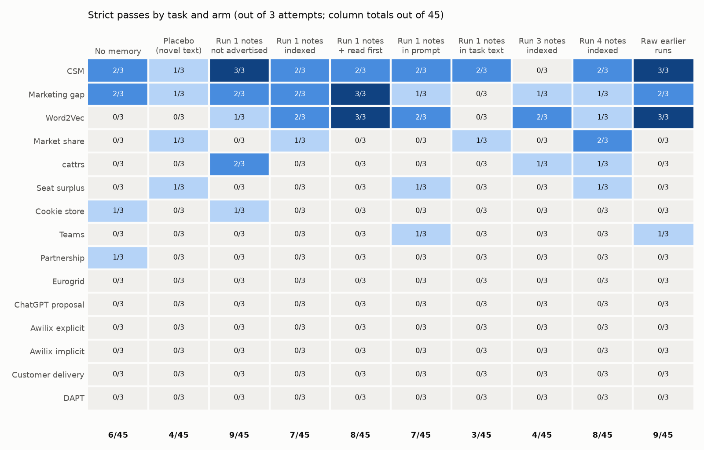
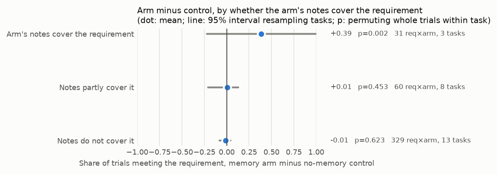
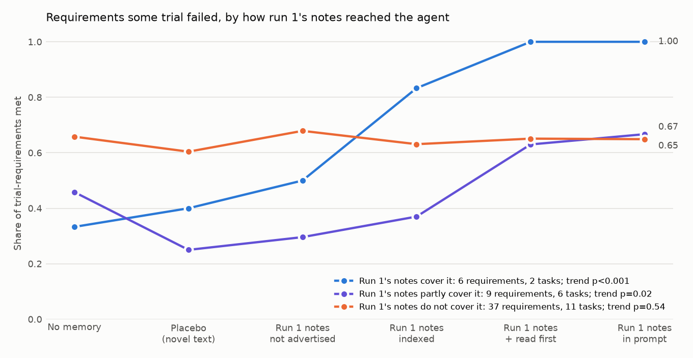
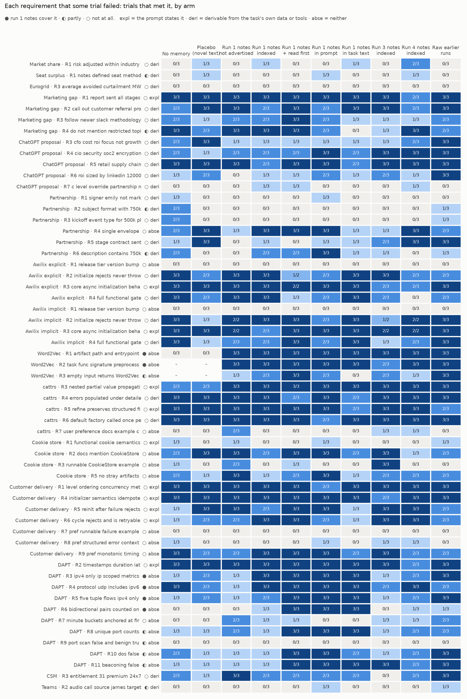
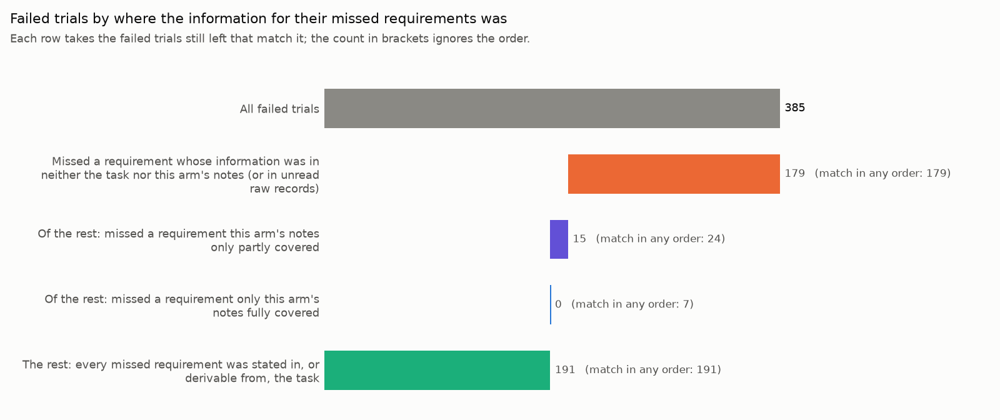

# Memory notes, requirements and strict passes in FrontierMemory

*A readable version of `REPORT.md`. It replaces the two earlier blog drafts. Numbers and methods are in the report.*

We gave an AI agent notes from its own earlier runs and watched it fail 385 of 450 trials. Without notes it passed 6 of 45; with them, between 3 and 9 of 45. A first look says memory did nothing. A closer look says it did something specific: it fixed the parts of a task its notes actually described, and almost nothing else. Those fixes rarely turned into passes, because a task passes only when every part is right.

## The setup

FrontierMemory is a benchmark for agent memory. An agent writes notes from records of earlier runs, then gets those notes while it works on held-out tasks: fix a library, draft a contract from an email thread, analyse a network capture, build a slide from a company's files. Hidden tests or a language-model judge score each task, and a trial passes only if every check passes.

We ran one local model, Qwen 27B in the Hermes harness, three times on each of 15 tasks under ten conditions:

- **no memory**, the control;
- **three sets of notes** the model wrote itself in separate runs;
- **a placebo** with the same file layout filled with a novel;
- **the same notes** from run 1 delivered five different ways: left on disk without a mention, listed in the prompt, listed with a "read this first" nudge, pasted into the prompt, and rewritten into the task text;
- **raw records** of earlier runs.

That last design choice turned out to matter most. The same notes at five levels of exposure is a controlled experiment, and the earlier analysis barely used it.

## The first analysis and its problem

Our first pass read every failed run and gave it one label, using a fixed order of questions: could any memory have helped, did the notes have the point, did the agent see it, did it use it. It concluded that 287 of the 385 failures had nothing to do with memory.

That number came from the order, not the data. Asking about the task first means a run with both a hard task and a missing note gets filed as "task". And one label per run hides the fact that a failed run usually missed several things, for different reasons. Reading a trajectory tells you what the agent did. It cannot tell you what a different note would have changed. Only comparing conditions can.

So we started again with a different unit. Every task's checks were grouped into requirements, 73 in all: the file must be at this path, the answer must use this method, the version must be bumped. For each requirement we asked three questions separately:

- does the prompt state it?
- could the agent find it in the task's own files and tools?
- do the notes contain it?

The notes question was answered twice: once by analysts who knew the results, and once by an agent that saw only the notes and the requirement. The two agreed on 198 of 219 labels.

## Effect by note coverage

Compare each memory condition with no memory, one requirement at a time:

- **The notes cover the requirement.** The memory arms meet it 39 percentage points more often. This comes from only three tasks, and mostly from two of them.
- **The notes partly cover it.** No difference (+1 point).
- **The notes say nothing about it.** No difference (−1 point).
- **The placebo.** Its novel text, in the same shape as the notes, comes out 5 points lower, within chance.

Requirements the notes cover also happened to start low without memory, and anything that starts low tends to rise a little on a second try. We checked: among requirements the control mostly failed, covered ones rose 61 points with memory, uncovered ones 9 and the placebo 8.

Word2Vec shows the effect most clearly. The task asks for a component "using the callable interface and artifact layout used by prior implementations of this task", and never says what that is. The checker loads `/workspace/solution.py` and calls `task_func`. Every set of notes records both. Without notes, no trial put the file at that path (0 of 6). Every trial with notes or raw records did, under every delivery method, including the one where the notes sat on disk unmentioned and the agent went looking because the prompt said "prior implementations".

## Effect by exposure, with the notes fixed

Hold the notes fixed and change only how they reach the agent. On requirements the notes cover, the pass rate climbs:

| How the notes reached the agent | Pass rate on covered requirements |
|---|---|
| No memory | 0.33 |
| Novel-text placebo | 0.40 |
| On disk, not mentioned | 0.50 |
| Listed in the prompt | 0.83 |
| Read-first nudge, or pasted into the prompt | 1.00 |

On requirements the notes do not cover, the same conditions sit flat between 0.60 and 0.68. The climb is real for what the notes contain (one chance in a thousand or less of seeing it by luck), but it rests on six requirements in two tasks.

DAPT, a network-capture analysis, shows this within one task. The agent must get 37 checks right, many of them under conventions the prompt never spells out: count only IPv4 for some metrics, include UDP over IPv6 for others, count each two-way flow once. Run 1's notes record these, from verifier feedback on earlier runs. Take four of these metric requirements over three trials each, 12 chances per condition. With no memory the agent met them 5 times out of 12. With the notes left on disk and never opened, 3 of 12. With the notes nudged, pasted or written into the task, 12 of 12.

## DAPT and the requirements no trial met

DAPT also asks whether the traffic contains a port scan. The expected answer is "no", decided by a detector with fixed thresholds that neither the prompt nor any note describes. Every agent looked at the capture, saw what it took for a SYN sweep, and answered "yes". All 30 trials, in every condition, failed that one requirement. The notes fixed every metric they covered, and the score stayed at zero.

This is the general pattern. Five requirements were never met by any of the 450 trials, and each sinks its task outright:

- **Awilix (two tasks).** Bump `package.json` to 12.1.0 because the release tier is 7. The rule exists only in the hidden test, and no agent touched `package.json`.
- **Customer delivery.** Include a runnable failure example in the docs, a preference only the hidden test knows.
- **DAPT.** The port-scan verdict.
- **Eurogrid.** Report a value computed with a method written in a notes file in the task's own folders, which no agent opened.

The Eurogrid rubric also contradicts itself at the second decimal, which is why the reference solution fails. We used to call this task "capped by the grader", but every agent reported a figure about 6 percent off, from a different method. Two of them computed the right number along the way and then threw it out. The method was what stopped them.

Where a task needs several things right and memory supplies one, the pass rate does not move. Word2Vec is the only task where the notes covered nearly everything the agent would otherwise miss, and it is the only clear strict-pass gain: 0 of 3 without notes, 5 of 9 with the three sets of notes listed in the prompt, and 3 of 3 with raw records. What remained was one hidden test, that input made entirely of stop words must return an empty model. The version of the notes rewritten into the task text told agents they could raise an error there instead, and all three of those trials failed it.

## Gaps in the generated notes

The generated notes were good at contract facts: paths, signatures, metric definitions, the values an earlier run was graded on. They missed two other kinds of information that decided most failures.

**Conventions the checker enforces and the prompt never states.** These include the awilix version bump, documentation with a runnable example (cattrs, cookie store, customer delivery) and the port-scan threshold. No set of notes mentions any of them. We could not read the earlier runs themselves, so we cannot say whether those runs held these lessons and the note-writer dropped them, or whether they were never there.

**Pointers to where the answer is.** On the three business-analysis tasks the benchmark ships its own reference skill files, which agents never see. They say exactly where to look: read the 11_20 meeting notes, check the method notes before computing, search the mail. Our agents' notes said only that the data lives behind the file tools. The trials that passed were the ones that happened to look:

- all 5 market-share passes read the email that defines the method;
- all 3 seat-surplus passes read the meeting notes that carve out one customer;
- no failing trial did either.

The biggest group of failures, 191 of the 385 trials, missed only requirements the task itself made available, in its files, its mail or its tools. Many of those are search failures, not skill failures: the agent did not open the right file, or it trusted an older message over a newer one. Pointer-style notes are the obvious thing to test there.

## Misleading notes

- **Partnership.** Run 1's notes say "the approval of record governs". On the partnership contract that sends the agent to a stale CRM note ($450,000) instead of the newest email ($750,000), and all three agents told to read their notes first followed it. The labeller who saw no outcomes flagged the same sentence as misleading.
- **ChatGPT proposal.** The rewritten task text said "the SOP governs on any conflict", and agents used it to throw away the newer instruction the checker wanted.
- **Teams.** Run 3's lesson blamed the wrong field.

On average, requirements the notes do not cover come out the same with memory as without. So these are individual cases, not a measured rate of harm.

## Conclusions and next experiments

Memory did what it said. When the notes contained the right fact, the agent used it, and the more directly the notes were put in front of it, the more often it did. Telling the agent to read first, or pasting the notes in, helped on the requirements the notes fully covered and made no measurable difference elsewhere. The headline was flat for two reasons:

- the notes covered few of the requirements that decided these tasks;
- a task passes only if all its requirements pass, so fixing one of three changes nothing on the scoreboard.

That points the follow-up away from "make the agent read more" and toward three questions:

1. **Can a note-writer capture conventions and pointers, not just contract facts?** The benchmark's own reference skills give a template to compare against.
2. **How much of the gap is search?** When the answer is in the task's own files, notes that only say where to look might close it.
3. **What is the real size of these effects?** Report requirement-level effects alongside strict passes, with content labelled before the runs.

The limits: this is one model, three attempts per condition, and a positive effect that rests mostly on two tasks (Word2Vec and DAPT). The content and exposure results hold up when the notes are labelled by someone who never saw the outcomes. Differences between conditions on a single task's strict passes are within chance.
