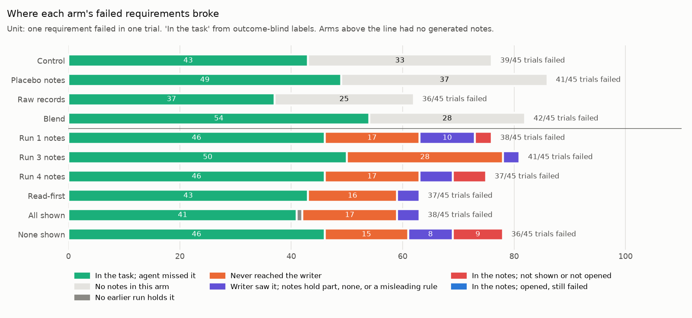
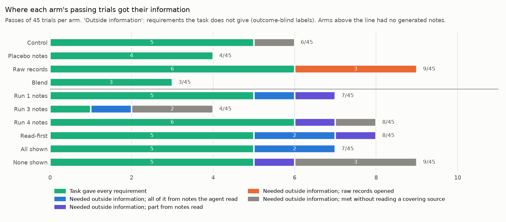

# Where 385 memory failures broke

*A readable version of `REPORT.md`, which has every number and method. It replaces the earlier blog drafts.*

We gave an AI agent notes it had written from 750 records of earlier runs by other agents, and it failed 385 of 450 trials. Without notes it passed 6 of 45; with them, between 3 and 9 of 45. A first look says memory did nothing.

So we asked where each failure broke, following the information from the earlier runs to the agent's answer. Was the experience never there? Did the note-writer lose it? Did the harness fail to show the notes? Did the agent ignore them, or misuse them? Did it have what it needed and still get it wrong? Or did the grader fail it unfairly?

Most failures broke in one of two places. The agent missed information its own task gave it, usually information it would have had to search for. And the note-writer lost most of what the earlier runs had learned that the task did not give. Missing experience, the harness and the grader decided almost nothing.

## The setup

FrontierMemory is a benchmark for agent memory. An agent writes notes from records of earlier runs, then gets those notes while it works on held-out tasks: fix a library, draft a contract from an email thread, analyse a network capture, build a slide from a company's files. Hidden tests or a language-model judge score each task, and a trial passes only if every check passes.

We ran one local model, Qwen 27B in the Hermes harness, three times on each of 15 tasks under ten conditions:

- **no memory**, the control;
- **three sets of notes** the model wrote in separate runs;
- **a placebo** with the same file layout filled with a novel;
- **the same notes** from run 1 delivered five ways: left on disk without a mention, listed in the prompt, listed with a "read this first" nudge, pasted into the prompt, and rewritten into the task text;
- **raw records** of earlier runs.

## Method

Our first analysis gave each failed run one label, by asking questions in a fixed order: could any memory have helped, did the notes have the point, did the agent see it, did it use it. It concluded that 287 of the 385 failures had nothing to do with memory. That number came from the order: asking about the task first files a run with both a hard task and a missing note as "task". It also rested on a guess about the earlier runs, which we had not read.

This time the unit is the requirement. Every task's checks were grouped into requirements, 73 in all: the file must be at this path, the answer must use this method, the version must be bumped. 57 of them failed at least once. For each one we recorded:

- whether the prompt or the task's own files give it. An agent that saw only the task, never an outcome, made these labels;
- whether any earlier run holds it;
- whether it reached the note-writer, from the writer's own session;
- whether the notes contain it, labelled by an agent that saw only the notes;
- whether the agent saw and opened those notes.

Then we compared conditions. Reading a trajectory tells you what the agent did. Only comparing conditions tells you what a different note would have changed. An independent reviewer rebuilt the main table from the raw files and checked the rest.

The ten conditions are different treatments, so each count below is either per condition or per requirement. An earlier draft added up the 742 failed requirement-trials across all ten conditions. That mixed treatments, counted run 1's notes four times, and let a few requirements that fail in nearly every trial dominate: eight requirements give 233 of the 742.

## Where the failures broke

| Where it broke | Result |
|---|---|
| No earlier run held the information | 5 of the 57 failed requirements; only 1 of those is one the task does not give |
| The writer never saw it, or cut it down | Of the 19 failed requirements the task does not give, one has no earlier run. Of the other 18, run 1's and run 4's notes lack 12 each and run 3's 17. Never reached the writer: 7, 7 and 14 |
| The notes had it, but the condition showed nothing | Only in the condition built for that: 9 failed requirement-trials |
| The notes were listed, but the agent never opened them | Only in the run 1 and run 4 conditions: 3 and 6 |
| The agent read a note that fully covered the requirement and still failed | Never: 60 of 60 met, on 8 requirements in Word2Vec and DAPT |
| The agent read a note that partly covered it, or misled, and still failed | A third or more of the time in each condition that showed many: all shown 12 of 36, read-first 8 of 25, run 1 6 of 14 |
| The task gave the information and the agent missed it | 38 of the 57 failed requirements. Each condition missed 23% to 34% of these, control 27%; no condition differs from control beyond chance (every p ≥ 0.19) |
| A grader defect decided the outcome | Once: DAPT's port-scan question, whose expected answer contradicts the test's own definition of a scan |

On what the task does not give, leaving out Word2Vec, which the control does not measure, each condition missed this share of those requirement-trials:

| No memory | Placebo | Raw records | Rewritten task | Run 1 | Run 3 | Run 4 | On disk only | Read-first | Pasted in |
|---|---|---|---|---|---|---|---|---|---|
| 0.63 | 0.71 | 0.52 | 0.52 | 0.60 | 0.60 | 0.56 | 0.63 | 0.42 | 0.44 |

Read-first and pasted-in miss less, almost all on DAPT (control 16 misses, those two 5 and 6), but with three trials each that difference is not significant on its own (p = 0.20 and 0.24). The content test and exposure ladder below are the tests that hold up. The never-met conventions on awilix and customer delivery are missed in every condition.

What counts as "the task gives it" is a judgement. If only what the prompt states outright counts, most of the in-task misses move to the writer: in the pooled counts (all conditions summed, so for reference only), 455 failed requirement-trials become 51, and the writer's share grows from 145 to 387. Our labellers, and separately the auditors who built the requirements, judged that a method in a mail thread or the newer of two emails is something the task gives.

With 45 trials per condition, differences of a few failures are noise. The comparisons that test memory causally are the content test and the exposure ladder below.

## Where the successes came from

The same question for the 65 passes:

- **45 were on tasks where the task gives every requirement:** CSM, marketing, market share, seat surplus, Teams and partnership. Every condition has 1 to 6 of these, the control 5. They came from finding what the task gave; on market share and seat surplus every pass read the file that defines the method, and no failure did. Memory was there in 14 of them, and in 4 the agent read notes that partly cover a requirement, so we cannot say memory played no part.
- **14 needed information the task does not give, and opened memory to get it.** All are Word2Vec, and every one of them opened the notes or the raw records, or had the notes pasted in. Without memory, Word2Vec passed 0 of 6 times: those agents never put the file where the tests look for it, so the other tests never ran.
- **6 needed outside information and met it with no memory covering it:** cattrs, whose convention the model follows almost always, and cookie store, where the two passes are the trials that happened to meet two conventions most trials miss. The control passed cookie store once.

At the level of single requirements, the pattern repeats. When the agent read a note that fully covered a requirement, it met it every time (seven requirements, on Word2Vec and DAPT). When the notes said nothing about a requirement, the agent met it as often as the control did on the same requirements (62 times against 64 expected). Requirements the prompt states were met 83 to 92% of the time in every condition; requirements that need a search, 21 to 41%. Every memory condition except raw records met fewer of the search requirements than the control, by 2 to 8, but none by more than chance would give on its own.

One requirement was clearly met only with memory: Word2Vec's file path, 24 of 24 times with memory or records and 0 of 6 without. Two of DAPT's counting rules were also never met without memory, but in too few trials to be sure.

## The agent missed what its task gave it

In every condition, 20 to 27 of the 45 trials failed only on things their own task told them, in its prompt, files, mail or tools. Most of these are search failures, not skill failures:

- **Market share.** All 5 passes read the mail thread that defines the method, and no failure did. Most failures reached the data, but they searched mail for "market share" and the subject line says "market-share".
- **Seat surplus.** All 3 passes read the meeting notes that carve out one customer, and no failure did. 14 of the 27 failures never reached the task data, and 14 ran under three minutes.
- **Older over newer.** On the contract, marketing and proposal tasks, agents trusted an older message over a newer one.
- **Teams.** Agents skipped the call's `source` field, which the tool schema calls optional. Whether the task really gives this one is arguable: the prompt names the caller but not the field.

The benchmark ships reference notes for its business tasks that say exactly where to look: read the 11_20 meeting notes, check the method notes, search the mail. Our writers' notes said only that the data lives behind the file tools.

This group also limits what notes of facts could have done. If every trial had been handed everything its task lacks, and nothing else changed, a condition could pass at most 13 to 19 of 45. The control's ceiling is 17, the same as the conditions with notes, so the limit is in the tasks. Notes that point to the right file could in principle get past it; we have not tested that.

## The earlier runs

The first analysis said "the corpus has no related run" for the coding tasks that never pass. Reading the corpus, the tracers found the information fully for 32 of the 57 failed requirements and partly for 20; only 5 had nothing. They searched knowing what they were looking for, so a writer searching without that knowledge might have found less.

Some of it is from earlier runs of the same task. Partnership has 22 earlier runs and exactly one passes, with Emily as signer at $750,000, which is what the checker wants. The content-gap task's three passing runs show its exact answer. Word2Vec's one passing run returns an empty model when the input is all stop words; that hidden test tripped 10 of our 24 trials where it ran.

The rest is lessons from other tasks, and these surprised us. The awilix tasks fail because the hidden test wants `package.json` bumped from 12.0.5 to 12.1.0 for "internal release tier 7", and nothing in the task says so. Ten earlier runs in other repositories carry a consistent rule. The user says "this one's internal release tier is 6" and later "bump the minor version"; tier 5 gets a patch, tier 8 a minor, tier 9 a major. Customer delivery fails because the docs need "a runnable failure example". An earlier run has a maintainer asking for "one runnable failure or cancellation example" in nearly those words.

## The note-writer

Take the 19 failed requirements the task does not give. Run 1's and run 4's writers never saw 7 of them, and their notes hold 6. Run 3's writer never saw 14, and its notes hold 1. The writers' sessions show why:

- **They read mostly first messages.** All three summarised each earlier run from its opening request, and run 4 added the final message. The maintainers' follow-up turns, where most of those coding conventions live, were never printed.
- **Their parsers mishandled whole formats.** The corpus mixes three log formats. In one of them an environment turn comes first, so "first message" meant the environment preamble. Even a request that said "this one's internal release tier is 8" was never printed. One writer's extractor returned empty text for another format, a second marked 137 files unknown, and a third filtered by the wrong field name and dropped the email that held the content-gap answer. The passing partnership run was among the misread files.
- **They cut what they printed.** Excerpts were trimmed to 150, 300 or 500 characters. One writer opened Word2Vec's passing run, and its 300-character print stopped just before the empty-input fallback. So the notes say empty input raises an error, which is what a failing run did.
- **One kept the wrong lesson.** Run 1's rule for contract tasks, "the approval of record governs", comes from the closing summary of a failing earlier run. The one passing run did the opposite.

What survived was contract facts that sit in a first message or a verifier line: Word2Vec's file path and function name, DAPT's metric definitions, CSM's entitlement.

## Notes that reached the agent

Compare each memory condition with no memory, one requirement at a time:

- **The notes cover the requirement.** The memory conditions meet it 39 percentage points more often (p = 0.002 within these tasks). That averages conditions with different exposure: 67 points with the notes nudged or pasted in, 33 to 47 with runs 1 and 4 listed, 7 with the notes on disk only and 8 with run 3's, whose one covering note (CSM's) was never opened. The three listed sets of notes alone give 31 points (p = 0.006). This rests on three tasks, mostly two, and resampling tasks gives a range from −22 to +100 points.
- **The notes partly cover it.** +1 point on average, but that is tasks cancelling: partnership −38 and marketing −21, the two tasks with the misleading rules described below, against DAPT +15.
- **The notes say nothing about it.** No difference (−1 point).
- **The placebo.** −5 points, within chance.

Covered requirements also happened to start low without memory, and anything that starts low tends to rise a little on a second try. Among requirements the control mostly failed, covered ones rose 61 points with memory, uncovered ones 9 and the placebo 8.

Hold run 1's notes fixed and change only how they reach the agent. On requirements the notes cover, the pass rate climbs:

| How the notes reached the agent | Pass rate on covered requirements |
|---|---|
| No memory | 0.33 (DAPT only; Word2Vec is not measured without notes) |
| Novel-text placebo | 0.40 (DAPT only) |
| On disk, not mentioned | 0.50 |
| Listed in the prompt | 0.83 |
| Read-first nudge, or pasted into the prompt | 1.00 |

Requirements the notes cover partly rise more weakly, and that rise depends on whose labels you use. Requirements they do not cover sit flat between 0.60 and 0.68.

The climb past "notes present" comes from one task. DAPT, a network-capture analysis, needs 37 checks right, many under conventions the prompt never spells out: count only IPv4 for some metrics, include UDP over IPv6 for others, count each two-way flow once. Run 1's notes record these, from verifier feedback on earlier runs. On four of those metrics over three trials each, the agent met them 5 times in 12 with no memory. With the notes on disk and never opened, 3 of 12. Listed, 9 of 12. Nudged or pasted, 12 of 12.

Every trial that opened a note fully covering a requirement, or had it pasted in, met that requirement: 60 of 60, all on Word2Vec and DAPT. Partial notes were another matter. Within each task, reading one went with meeting the requirement more often (the agent chose what to read, so this is not a controlled comparison): DAPT's partly covered requirements were met 19 of 24 times when opened against 12 of 33 when not, partnership's 4 of 12 against 0 of 6. But a read partial or misleading note still failed in 22 of 81 cases, not counting DAPT's port-scan question. An earlier version of this write-up called DAPT the clearest case of agents ignoring their notes: the notes said not to infer a port scan from many destination ports alone, and every agent reported one anyway. The agents were right. The test's own comment defines a scan as more than 500 ports against one target, and the capture has a 1,000-port sweep against one target.

## Why the scoreboard stayed flat

A task passes only if every requirement passes. Notes that fix one requirement of three change nothing on the scoreboard.

DAPT also asks whether the traffic contains a port scan. The expected answer is "no", but that is a defect in the task. The capture holds a 1,000-port SYN sweep from one host against one target, almost all of it within one minute, and the test's own comment defines a scan as more than 500 ports against one target. The reference solution reaches "no" only because an unrelated SSH session from the same host dilutes its statistics, and the thresholds it uses were in skill files the task was built without. Every agent found the sweep and answered "yes". All 30 trials failed that requirement, and three of them failed nothing else. The earlier runs' feedback pushed toward "no", which taught the expected answer rather than a correct analysis.

Five requirements were never met in 450 trials, and each sinks its task outright:

- **Awilix, two tasks:** the release-tier version bump. A consistent rule is in the earlier runs; no writer read it.
- **Customer delivery:** a runnable failure example in the docs. Also in the earlier runs; also never read. 17 trials wrote exactly such a program, but in a scratch file instead of the docs.
- **DAPT:** the port-scan verdict, a defect in the task (above).
- **Eurogrid:** a value computed with a method written in a notes file in the task's own folders, which no agent opened. Every agent's figure was about 6% off. Two of them computed the right number along the way and threw it out. The rubric also contradicts itself at the second decimal, but that decided no trial.

Word2Vec is the one task where the notes covered nearly everything the agent would otherwise miss, and it is the only clear gain in strict passes: 0 of 3 without notes, 5 of 9 with the three sets of notes listed, 3 of 3 with raw records. What remained was the empty-input test, and the earlier runs held the answer to that too.

## Misleading notes

- **Partnership.** Run 1's "approval of record governs" sends the agent to a stale CRM note ($450,000) instead of the newest email ($750,000). All three agents told to read their notes first followed it. But agents with no real notes picked the wrong signer too: the note reinforced a mistake the model makes anyway.
- **Marketing.** Run 1's "follow the written policy exactly" led the one agent that opened it to an older email.
- **ChatGPT proposal.** The rewritten task text said "the SOP governs on any conflict", and agents used it to discard the newer instruction the checker wanted.
- **Teams.** Run 3's lesson blamed the wrong field.

On average, requirements the notes do not cover come out the same with memory as without. These are individual cases, not a measured rate of harm.

## Conclusions and next experiments

When the notes held the right fact in full, the agent used it, and the more directly the notes reached it, the more often. The headline was flat for three reasons:

- the notes held little of what decided these tasks;
- most failed trials also missed something their own task gave;
- a task passes only if all its requirements do.

The writers' sessions show where the notes' content stopped: first-message extraction, parsers that misread two log formats, sampling and truncation. That is a trace, not yet a test.

The follow-up questions, in order:

1. **Rerun the writer with a reader that sees every turn and every log format**, same model and budget, and measure how many of the 73 requirements the new notes cover.
2. **Add the lost conventions by hand** (the release-tier rule, the runnable example, the `source` field) and rerun. If the never-met requirements start passing, the missing content was what held those tasks back, and the writer is where it was lost.
3. **Test pointer notes** on tasks whose answers sit in the task's own files, which is where most failures were.
4. **Test whether agents act on partial notes** by pairing each with a version that states the rule in full.
5. **Report requirement-level effects** alongside strict passes, with content labelled before the runs.

The limits: one model, three attempts per condition, and a positive effect that rests mostly on two tasks, Word2Vec and DAPT. The content, prompt and exposure results hold when labelled by agents that never saw the outcomes. The corpus verdicts were made by tracers who knew what they were looking for. Differences between conditions on a single task's strict passes are within chance.
