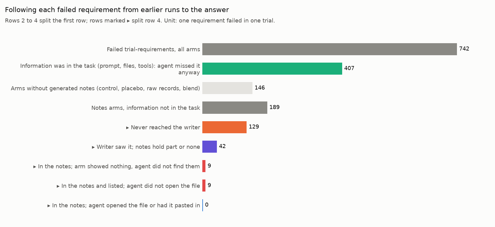
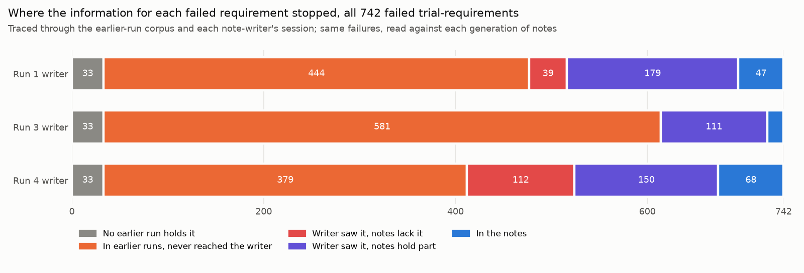

# Where 385 memory failures broke

*A readable version of `REPORT.md`, which has every number and method. It replaces the earlier blog drafts.*

We gave an AI agent notes it had written from its own earlier runs, and it failed 385 of 450 trials. Without notes it passed 6 of 45; with them, between 3 and 9 of 45. A first look says memory did nothing.

So we asked where each failure broke, following the information from the earlier runs to the agent's answer. Was the experience never there? Did the note-writer lose it? Did the harness fail to show the notes? Did the agent ignore them, misuse them, or have what it needed and still get it wrong? Or did the grader fail it unfairly?

The answer is mostly two places. The writer lost most of what the earlier runs had learned. And the agent missed a lot that its own task files told it. Missing experience, the harness and the grader decided almost nothing, and when the right note reached the agent, the agent used it.

## The setup

FrontierMemory is a benchmark for agent memory. An agent writes notes from 750 records of earlier runs, then gets those notes while it works on held-out tasks: fix a library, draft a contract from an email thread, analyse a network capture, build a slide from a company's files. Hidden tests or a language-model judge score each task, and a trial passes only if every check passes.

We ran one local model, Qwen 27B in the Hermes harness, three times on each of 15 tasks under ten conditions:

- **no memory**, the control;
- **three sets of notes** the model wrote itself in separate runs;
- **a placebo** with the same file layout filled with a novel;
- **the same notes** from run 1 delivered five ways: left on disk without a mention, listed in the prompt, listed with a "read this first" nudge, pasted into the prompt, and rewritten into the task text;
- **raw records** of earlier runs.

## Method

Our first analysis gave each failed run one label, by asking questions in a fixed order: could any memory have helped, did the notes have the point, did the agent see it, did it use it. It concluded that 287 of the 385 failures had nothing to do with memory. That number came from the order: asking about the task first files a run with both a hard task and a missing note as "task". It also rested on a guess about the earlier runs, which we had not read.

This time the unit is the requirement. Every task's checks were grouped into requirements, 73 in all: the file must be at this path, the answer must use this method, the version must be bumped. The 385 failed trials missed 742 requirements between them. For each one we recorded:

- whether the prompt or the task's own files give it;
- whether any earlier run holds it;
- whether it reached the note-writer, from the writer's own session;
- whether the notes contain it, labelled by an agent that saw only the notes;
- whether the agent saw and opened those notes.

Then we compared conditions. Reading a trajectory tells you what the agent did. Only comparing conditions tells you what a different note would have changed.

## Where the failures broke

| Where it broke | Failed requirements (of 742) |
|---|---|
| No earlier run held the information | 33, all requirements the prompt states anyway |
| The writer never saw it, or cut it down (trials with notes, information not in the task) | 171 of 189 |
| The notes had it but the condition showed nothing | 9 |
| The notes were listed but the agent never opened them | 9 |
| The agent opened the right note and still failed | 0 |
| The task itself gave the information and the agent missed it | 407 |
| The grader's one defect decided the outcome | 0 |

The rest are trials in conditions without generated notes. The two big rows are the story.

## The earlier runs

We expected the earlier runs to be thin. The first analysis said "the corpus has no related run" for the coding tasks that never pass. Reading the corpus, it holds what 709 of the 742 failed requirements needed.

Some of it is from earlier runs of the same task. Partnership has 22 earlier runs and exactly one passes, with Emily as signer at $750,000, which is what the checker wants. The content-gap task's three passing runs show its exact answer. Word2Vec's one passing run returns an empty model when the input is all stop words, the hidden test that tripped most of our agents.

The rest is lessons from other tasks, and these are the surprises. The awilix tasks fail because the hidden test wants `package.json` bumped from 12.0.5 to 12.1.0 for "internal release tier 7", and nothing in the task says so. Ten earlier runs in other repositories carry the rule. The user says "this one's internal release tier is 6" and later "bump the minor version"; tier 5 gets a patch, tier 9 a major. Customer delivery fails because the docs need "a runnable failure example". An earlier run has a maintainer asking for "one runnable failure or cancellation example" in nearly those words.

## The note-writer

Across the three sets of notes, the information behind 51 to 78% of the failed requirements never reached the writer at all. Only 2 to 9% made it into the notes. The writers' sessions show why:

- **They read the first message only.** All three summarised each earlier run from its opening request, and run 4 added the final message. The maintainers' follow-up turns, where every one of those coding conventions lives, were never printed.
- **Their parsers missed whole formats.** The corpus mixes three log formats. One writer's extractor returned empty text for one of them, another marked 137 files unknown, and a third filtered by the wrong field name and dropped an email body. The passing partnership run and all three passing content-gap runs were in the formats they missed.
- **They cut what they printed.** Excerpts were trimmed to 150, 300 or 500 characters. One writer opened Word2Vec's passing run, and its 300-character print stopped just before the empty-input fallback. So the notes say empty input raises an error, which is what a failing run did.
- **One took the wrong lesson.** Run 1's rule for contract tasks, "the approval of record governs", comes from the closing summary of a failing earlier run. The one passing run did the opposite.

What survived was contract facts that sit in a first message or a verifier line: Word2Vec's file path and function name, DAPT's metric definitions, CSM's entitlement.

## Notes that reached the agent

Compare each memory condition with no memory, one requirement at a time:

- **The notes cover the requirement.** The memory conditions meet it 39 percentage points more often (p = 0.002). This rests on three tasks, mostly two.
- **The notes partly cover it.** No difference (+1 point).
- **The notes say nothing about it.** No difference (−1 point).
- **The placebo.** −5 points, within chance.

Covered requirements also happened to start low without memory, and anything that starts low tends to rise a little on a second try. Among requirements the control mostly failed, covered ones rose 61 points with memory, uncovered ones 9 and the placebo 8.

Hold run 1's notes fixed and change only how they reach the agent. On requirements the notes cover, the pass rate climbs:

| How the notes reached the agent | Pass rate on covered requirements |
|---|---|
| No memory | 0.33 |
| Novel-text placebo | 0.40 |
| On disk, not mentioned | 0.50 |
| Listed in the prompt | 0.83 |
| Read-first nudge, or pasted into the prompt | 1.00 |

Requirements the notes cover partly rise more weakly. Requirements they do not cover sit flat between 0.60 and 0.68.

DAPT, a network-capture analysis, shows this inside one task. The agent must get 37 checks right, many under conventions the prompt never spells out: count only IPv4 for some metrics, include UDP over IPv6 for others, count each two-way flow once. Run 1's notes record these, from verifier feedback on earlier runs. On four of those metrics over three trials each, the agent met them 5 times in 12 with no memory. With the notes on disk and never opened, 3 of 12. With the notes nudged, pasted or written into the task, 12 of 12.

And the agent did not misuse what it read. Every trial that opened the note covering a requirement, or had it pasted in, met that requirement: 60 of 60. When the notes reached the agent, the only way to fail was not to open them, and that happened nine times.

## Strict passes and the never-met requirements

A task passes only if every requirement passes. Notes that fix one requirement of three change nothing on the scoreboard.

DAPT also asks whether the traffic contains a port scan. The expected answer is "no", decided by a detector with fixed thresholds that no prompt or note states. Every agent saw what looked like a SYN sweep and answered "yes". All 30 trials failed that requirement in every condition, and three of them failed nothing else. The earlier runs hold the answer only implicitly. Of the 35 earlier DAPT runs, the 30 that said "yes" got a port-scan complaint in their feedback, and the five that said "no" did not.

Five requirements were never met in 450 trials, and each sinks its task outright:

- **Awilix, two tasks:** the release-tier version bump. The rule is in the earlier runs; no writer read it.
- **Customer delivery:** a runnable failure example in the docs. Also in the earlier runs; also never read.
- **DAPT:** the port-scan verdict.
- **Eurogrid:** a value computed with a method written in a notes file in the task's own folders, which no agent opened. Every agent's figure was about 6% off. Two of them computed the right number along the way and threw it out. The rubric also contradicts itself at the second decimal, but that decided no trial.

Word2Vec is the one task where the notes covered nearly everything the agent would otherwise miss, and it is the only clear gain in strict passes: 0 of 3 without notes, 5 of 9 with the three sets of notes listed, 3 of 3 with raw records. What remained was the empty-input test, and the earlier runs held the answer to that too.

## Information in the task, missed

191 failed trials missed only things their own task told them, in its prompt, files, mail or tools. Many of these are search failures, not skill failures:

- **Market share.** All 5 passes read the mail thread that defines the method, and no failure did. Most failures reached the data, but they searched mail for "market share" and the subject line says "market-share".
- **Seat surplus.** All 3 passes read the meeting notes that carve out one customer, and no failure did. 14 of the 27 failures never reached the task data, and 14 ran under three minutes.
- **Older over newer.** On the contract, marketing and proposal tasks, agents trusted an older message over a newer one.
- **Teams.** Agents skipped the call's `source` field, which the tool schema calls optional. A passing earlier run had set it.

The benchmark ships reference notes for its business tasks that say exactly where to look: read the 11_20 meeting notes, check the method notes, search the mail. Our writers' notes said only that the data lives behind the file tools. Most of these requirements have their information in the earlier runs too, so better notes could reach this group as well.

## Misleading notes

- **Partnership.** Run 1's "approval of record governs" sends the agent to a stale CRM note ($450,000) instead of the newest email ($750,000). All three agents told to read their notes first followed it. But agents with no real notes picked the wrong signer too: the note reinforced a mistake the model makes anyway.
- **Marketing.** Run 1's "follow the written policy exactly" led the one agent that opened it to an older email.
- **ChatGPT proposal.** The rewritten task text said "the SOP governs on any conflict", and agents used it to discard the newer instruction the checker wanted.
- **Teams.** Run 3's lesson blamed the wrong field.

On average, requirements the notes do not cover come out the same with memory as without. These are individual cases, not a measured rate of harm.

## Conclusions and next experiments

Memory did what its contents allowed. When the notes held the right fact, the agent used it, and the more directly the notes reached it, the more often. The headline was flat because the notes held little of what decided these tasks. They held little because the writer read the first message of each earlier run, not because the earlier runs lacked the lessons.

That points the follow-up at the writer, not the reader:

1. **Rerun the writer with a reader that sees every turn and every log format**, same model and budget, and measure how many of the 73 requirements the new notes cover.
2. **Add the lost conventions by hand** (the release-tier rule, the runnable example, the `source` field) and rerun. If the never-met requirements start passing, the writer was the bottleneck.
3. **Test pointer notes** on tasks whose answers sit in the task's own files.
4. **Report requirement-level effects** alongside strict passes, with content labelled before the runs.

The limits: one model, three attempts per condition, and a positive effect that rests mostly on two tasks, Word2Vec and DAPT. The content and exposure results hold when the notes are labelled by someone who never saw the outcomes. The writer findings trace where information stopped; they do not yet show that putting it back would flip the trials. That is the second experiment above. Differences between conditions on a single task's strict passes are within chance.
