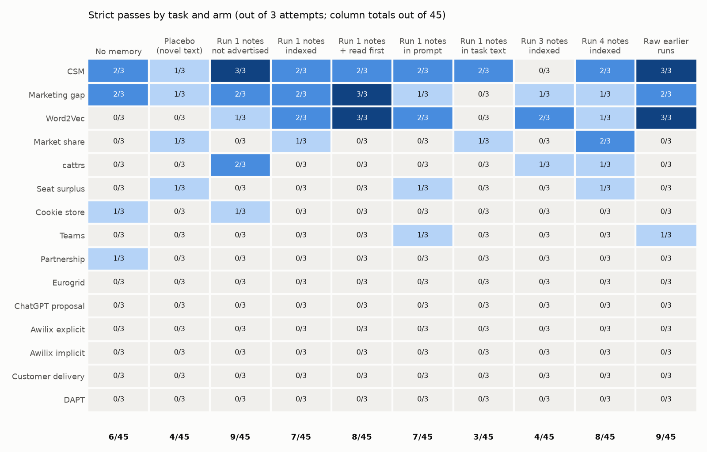
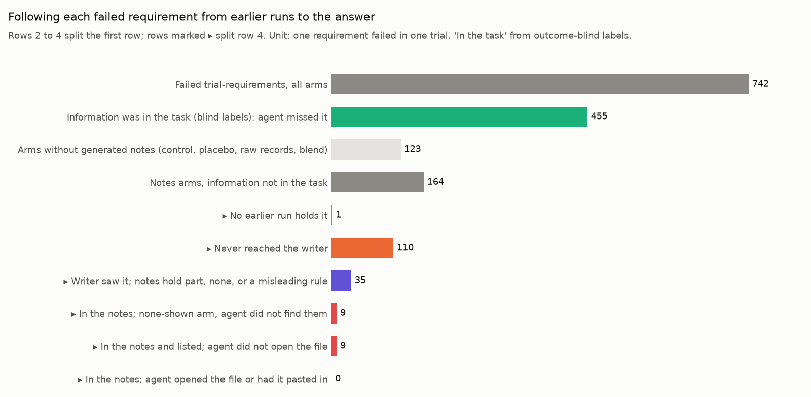
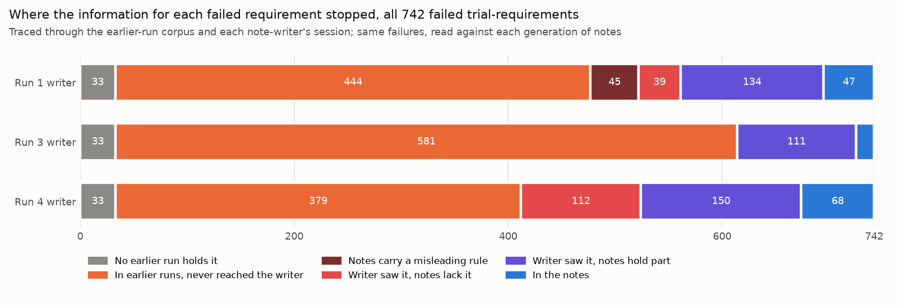
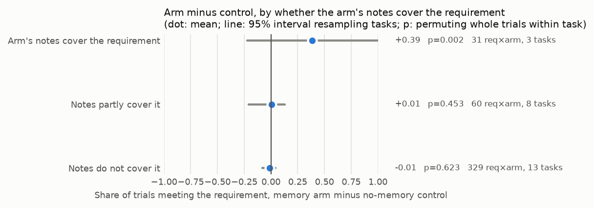
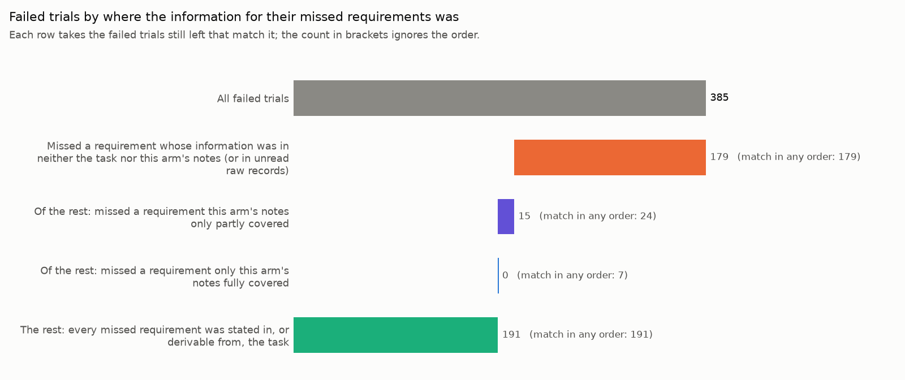

# FrontierMemory failure analysis: where 385 failures broke (450 trials)

This is the third version of the analysis. It replaces the v2 report (commit 9c4d3cc) and `REPORT-v1.md`, which is kept as the record of the first analysis. It also replaces the two Craft blog drafts and the Claude Docs blog. Every claim in those documents was checked against the data (561 claims, `claim-ledger` in section 10). What was correct is kept here; what was wrong is listed in section 8. `READABLE.md` is the shorter version.

**Terms used throughout.**

- **Hermes:** the agent harness.
- **Corpus:** 750 records of earlier agent runs by many other models (corpus v1.1), each one attempt at some task, sometimes with verifier feedback or a maintainer's follow-up instructions. It is gated material. For this version the owner authorised reading it, read-only; no corpus text is in this repository.
- **Writer, notes:** the model read the corpus in a separate session and wrote notes: a skill file plus reference files. Three sessions produced three generations (runs 1, 3 and 4). The notes are listed to the agent as a *skill index* in the system prompt.
- **Check:** one verifier test or rubric criterion.
- **Requirement:** a group of checks that fail together for one reason. There are 73, 72 of them scored.
- **Trial-requirement:** one requirement in one trial. The 385 failed trials contain 742 failed trial-requirements.
- **Auditors, blind labeller, tracers:** LLM agents (Claude) given written briefs. Section 3 says how their work was checked.
- **Task families:**
  - APEX: business analysis over a company's files and mail, graded by an LLM judge (market share, seat surplus, Eurogrid).
  - AutomationBench: workflow tasks graded by assertions on the end state (marketing, ChatGPT proposal, partnership).
  - EnterpriseOps: office-tool tasks graded by database checks (CSM, Teams).
  - DAPT: network-capture analysis.
  - Coding tasks: graded by hidden tests and preference checks (awilix, cattrs, cookie store, customer delivery, Word2Vec).
- **Forced-open follow-up:** an exploratory rerun with notes pasted into the prompt (section 4.9).

## Short version

We ran one local model (Qwen 27B in Hermes) on 15 FrontierMemory tasks, 3 attempts per task under 10 arms, 450 trials. Strict passes barely moved: 6 of 45 without memory, 3 to 9 of 45 with it. We asked where each failure broke, along the path information takes from earlier runs to the agent's answer:

1. Was the relevant experience missing from the earlier runs?
2. Did the note-writer lose it?
3. Did Hermes fail to show the notes?
4. Did the agent ignore them?
5. Did it misuse them?
6. Did it execute badly with the information in hand?
7. Did the verifier fail it unfairly?

The earlier analysis answered this with one label per failed trial, assigned in a fixed order, and the order decided much of the answer (section 1). This version traces each of the 742 failed trial-requirements through every stage it passed. Arm contrasts test the stages the design can test. Whether the task itself gave the information comes from outcome-blind labels (section 3).

| Stage | Failed trial-requirements | How we know |
|---|---|---|
| 1. Experience missing | 33 of 742 have nothing in the corpus; only 1 of them is a requirement the task does not give | Corpus searched for each requirement, with a search log that can be rerun |
| 2. Writer lost it (notes arms, information not in the task) | 145 of 164: 110 never reached the writer, 35 reached it and were dropped or cut down | Traced in each writer's session: what it ran, what it saw, what it wrote |
| 3. Not shown | 9, all in the arm built to show nothing | Delivery confirmed in every other trial, except that the read-first sentence is in the config only. Arm contrast: covered requirements met 0.50 on disk unmentioned vs 0.83 indexed |
| 4. Listed, not opened | 9 | Arm contrast: 0.83 indexed vs 1.00 with a read-first nudge or pasted in. This includes the harness's index design: generic descriptions, and a prompt that says to load a skill only for knowledge the agent lacks |
| 5. Opened, still failed | 0 where the note fully covered the requirement (60 of 60 met, all on Word2Vec and DAPT); 30 where the note only partly covered it or was flagged misleading | Observational: the agent chooses what to open |
| 6. Information was in the task, agent missed it | 455 (in 285 trials; the only failure in 224). For 268 the information had to be found by searching mail or files, or by choosing between conflicting sources | Descriptive |
| 7. Verifier defect decided the outcome | 0 | The one rubric defect (Eurogrid) decided no agent trial |

The other 123 failed trial-requirements are in arms without generated notes (control, placebo, raw records, blend), where the information was not in the task.

The story the stages tell:

- **The experience was mostly there.** The corpus holds the information fully for 463 of the 742 failed trial-requirements and partly for 246. For 251 the evidence is a same-task passing run or verifier feedback. That includes conventions behind requirements no trial ever met. Earlier maintainers had said "this one's internal release tier is 6" and later "bump the minor version", which is consistent with the rule the awilix test enforces. They had asked for "one runnable failure or cancellation example", which customer delivery's hidden preference wants. The tracers who judged this knew the requirement they were looking for (section 7).
- **The largest upstream loss was at the writer.** The writers extracted mostly first messages, so maintainer follow-ups never reached them. Their parsers mishandled two of the corpus's three log formats: one format put an environment turn first, so even the request turn holding the release tier was never printed. They also sampled a few examples per group and cut excerpts at 150 to 500 characters. Across the three generations, 51 to 78% of the failed trial-requirements had information that never reached the writer, and only 2 to 9% had it in the notes.
- **What reached the notes helped.** On requirements the notes cover, memory arms meet the requirement 39 points more often than control (p = 0.002, permuting within task). That rests on three tasks, and resampling tasks gives −0.22 to +1.00. With run 1's notes fixed, the rate climbs with exposure from 0.33 to 1.00 (trend p < 0.001). The graded part of that climb comes from DAPT alone. No agent that opened a note fully covering a requirement failed it. Partial or misleading notes that were opened did not protect the agent: 30 such failures.
- **Strict passes hid this.** A task passes only if every requirement does, and notes that covered one requirement of three changed nothing on the scoreboard. Word2Vec, the one task where the notes covered nearly everything, is the one clear strict-pass gain.
- **The largest single group is in the agent's own hands.** 224 failed trials missed only requirements their own task made available, and most of those needed a search: a mail thread not opened, an older message trusted over a newer one. That also bounds what memory could do here. Of the 227 failed trials in notes arms, only 57 missed nothing the task itself gave, so even perfect notes could have flipped at most 57. Those are the never-met conventions on awilix, customer delivery and DAPT, plus Word2Vec and one cookie-store trial.

What this does not show: that adding the lost conventions to the notes would have flipped those trials. The writer stages say where the information stopped. The causal evidence that putting information in front of the agent helps comes from the three tasks where the notes did cover a requirement. The direct test is a follow-up arm (section 6).

## 1. Problems with the earlier buckets

The earlier analysis asked four questions in a fixed order (could any memory have changed the outcome, did the memory contain the point, did it reach the agent, did the agent use it) and filed each failed trial at the first "no".

- **The order decided the answer.** Task and grader causes came first, so a trial with both a hard task and a memory problem was filed as task-side. The "287 of 385 not caused by memory" figure measured that order.
- **The unit was wrong.** A trial fails if any check fails. A trial that missed three requirements for three different reasons got one label.
- **The labels came from reading, not comparing.** A trajectory shows what the agent did. It cannot show that a different note would have changed the outcome; only arm contrasts can.
- **The first link was unobserved.** "The corpus has nothing for this task" rested on a prompt-similarity count, because the corpus was not read. Reading it reverses that link for most tasks (section 4.3).

Two factual errors sat inside the buckets too. "Grader caps the score" (32 trials) used the reference solution's score as the test, and four reference solutions score 0 for setup reasons: the two EnterpriseOps solutions replay an empty call log, and the cattrs and cookie-store references are code-only patches that predate the documentation preference. Agents pass all four tasks. And "beyond the model" (135 trials) merged three things: requirements the prompt never states, information the agent could have found in its task files and did not, and plain coding errors.

## 2. Setup

No new trials were run for this analysis; everything comes from the counted runs in the repository.

| Arm | What the agent got |
|---|---|
| Control | No memory |
| Run 1, run 3, run 4 | Notes the model wrote from the corpus, three independent generations (run 2 timed out and exported nothing), listed as a skill index in the prompt. Run 1: one skill, 13 files, 62 KB. Run 3: 6 files, 40 KB. Run 4: 7 files, 38.5 KB. The index descriptions are generic |
| Placebo | Run 1's file layout and sizes, with the text replaced by a novel |
| None shown | Run 1's notes staged on disk at `/tmp/hermes/memories`, nothing in the prompt about them (`/root/.hermes/memories` was an empty decoy) |
| Read-first | Run 1's notes plus one sentence asking the agent to read memory first |
| All shown | All 13 of run 1's files pasted into the system prompt |
| Blend | The task description rewritten by a model to carry run 1's notes. The rewrite succeeded on 12 of 15 tasks: awilix explicit and cookie store came back unchanged, and the partnership rewrite failed twice, so 9 blend trials ran the original text. Much of the text added to APEX tasks was harness boilerplate |
| Evidence | Raw corpus records staged as files, no note-writing step. 33 of 45 trials got records (none for awilix ×2, cattrs or customer delivery; one unrelated record for cookie store; the APEX records are mostly other tasks'). 27 of the 33 searched the records and 18 opened them |

Model, harness, reasoning effort and grader are the same in every arm. The arms are not all one-factor variations of each other:

- **Fixed content, varying delivery.** Placebo, none shown, run 1, read-first and all shown share run 1's content (the placebo shares only its form). They differ in how it is delivered; all shown pastes the files themselves, not the index.
- **Varying content.** Run 3 and run 4 have different content. Blend has different content, because the rewrite added and dropped material. Evidence differs in both content and form.

Delivery was checked in every trial from the saved prompts and configs:

- **Index and pasted files.** The skill index was in the prompt in every run 1, 3 and 4 trial. All 13 files were in the prompt in all 45 all-shown trials, about 16,000 extra tokens per request: +8% input tokens and +9% agent time against control. The largest prompt was 189,152 of 262,144 tokens, with no overflow and two compactions.
- **None shown and blend.** None shown injected zero bytes. The rewritten blend text was the first message in the 36 blend trials whose task was rewritten.
- **Read-first sentence.** It is in each trial's config but not in the saved prompt, because Hermes adds it at request time. Opens rose from 15 to 27 of 45 (13 of them on the first turn), which suggests it arrived, but the saved files cannot prove it.
- **Opens by arm** (trials that read a staged memory file): run 1 15, run 3 14, run 4 23, read-first 27, none shown 4, placebo 4, evidence 18, control 0, all out of 45.

**Run hygiene.** All 450 counted trials finished without an exception or an unavailable model, and none hit its time limit. Ten all-shown trials that overlapped a model-server stall were rerun, among them the Teams pass FkfBJWA, as were one placebo and two none-shown trials; the counted trials are the clean reruns. The trial data were copied from the VM disk on Nov 16 with writes discarded, and the disk's fingerprint was identical before and after.

## 3. Method

**Check-level outcomes.** `causal/checks.py` reads every counted trial's verifier output (pytest results, judge grades, assertion lists, preference gates) and records each check as passed or failed. In all 450 trials the strict reward equals "every check passed", and the per-arm pass counts match the published summaries.

Three details matter for scoring:

- **Excluded assertions.** AutomationBench marks a "must not send" assertion EXCLUDED when nothing violated it; we count that as passed. The marketing task's four assertions that were excluded in every trial form a requirement that is never scored.
- **Word2Vec without a solution file.** In six Word2Vec trials (control and placebo) the verifier could not load the solution. The file-path check counts as failed. The other five tests never ran, so those requirements are unmeasured in those trials.
- **Awilix tests that did not compile.** In four awilix trials the hidden test file failed type-checking. Those trials fail the build requirement once, and the behaviours it would have tested are unmeasured.

The old partial-credit files grouped DAPT's 37 verifier cases into 14 units; this analysis scores the 37 cases.

**Requirements.** Three auditors, five tasks each, grouped every check into requirements: 73 in all, 72 scored. For each requirement they recorded, from the files:

- whether the prompt states it (explicit), whether the agent could work it out from the task's own data and tools (derivable), or neither (absent);
- how many trials met it, by arm, and whether the reference solution meets it;
- whether each set of notes and the blend text contain what it needs (yes, partial or no), with file and quote;
- what failing agents did, from at least three trajectories each.

The auditors could see outcomes while labelling, so their explicit/derivable/absent labels are not blind.

**Blind prompt labels (new in this version).** Three agents relabelled all 73 requirements as explicit, derivable or absent. They saw only the requirement text, the prompt (`instruction.md`) and what the agent can reach (`environment/`, including the repositories at their base commits and the extracted world data). They saw no solution, test, README, task metadata, trial, score, audit or notes. For derivable requirements they also recorded how the information is found:

- direct: the prompt points to it;
- one-step: an obvious place a careful agent would look;
- search: across mail or files, or by choosing between conflicting sources.

They agree with the auditors on which side of "in the task" a requirement falls for 66 of 73 requirements. Where they differ they put more in the task, not less (6 auditor-absent became derivable or explicit, 1 the other way). The blind labels are primary for every stage count; the auditors' labels and an explicit-only reading are reported as sensitivity checks (section 4.2).

Two calls in the blind labels matter. DAPT's environment folder holds analysis scripts that settle several metric conventions, but the container copies only the capture and a template, so the labeller treated the scripts as out of reach and labelled those metrics absent. CSM's entitlement requirement is ambiguous between two entitlements and is labelled derivable with low confidence.

**Checking the auditors.** A fourth agent tried to refute the 14 claims that would change conclusions, and spot-checked about 45 memory quotes against the files.

- It refuted none. Four claims were partly wrong and have been corrected (section 8).
- It found a parser error of ours that added one failed check to every DAPT trial. We fixed it before computing anything here.
- A fifth agent then reviewed the v2 report against the outputs. Its corrections are included, among them the Word2Vec scoring above and the blend handling below.

**Blind content labels.** A separate agent labelled all 73 requirements against run 1's, run 3's and run 4's notes, without access to any trial, outcome or audit. It agreed with the auditors on 198 of 219 labels (kappa 0.77); most disagreements are an auditor's "partial" becoming "no". The blind labels are primary.

The blend text was not blind-labelled, so blend is left out of every comparison that depends on content. With the auditors' labels (blend included) the results agree: covered +0.35 (p = 0.001), partly covered −0.00, uncovered −0.03. Both sets of results are in `causal/out/`.

**Memory access.** `causal/access.py` finds every read of a staged memory file in each trajectory. It reproduces the published access logs (run 1 15 of 45, read-first 27 of 45) and finds no reads in control.

**Corpus and writer trace (new in this version).** Three tracers, five tasks each, answered four questions for every requirement:

1. **Corpus:** does any corpus record hold information an agent could act on to meet it? Status is present, partial or absent. Kind is same-task verifier feedback, a same-task passing run, a hint in a same-task failing run, or a lesson from another task. Each verdict comes with quotes, and each "absent" with a log of search terms and hit counts that can be rerun.
2. **Writer exposure, per generation:** did that information appear in what the writer actually saw, meaning the tool results in its session and any file it read? Where it did not, why not: filtered out, sampled away or truncated.
3. **Stage, per generation:** experience missing / writer never saw / writer saw and dropped / writer saw and kept part / in the notes. The blind notes label decides the last three.
4. **Unstated spec:** is the requirement known only to the hidden checker, neither stated nor derivable from the task?

`causal/stages.py` then follows every failed trial-requirement downstream:

- information in the task (explicit or derivable): *in the task, missed*;
- otherwise, in a notes arm, the writer stage for that arm's generation;
- if the notes hold it: the arm shows nothing and the agent did not find them (*harness did not show*); listed but the relevant file not opened (*not opened*); or opened or pasted in (*opened, still failed*).

Control, placebo, evidence and blend have their own labels, because they have no generated notes or no blind labels.

**Checking the tracers.** We reran the searches behind the claims that change conclusions directly against the corpus files:

- the release-tier statements and bump instructions (t0397, t0667, t0254, t0202, t0263);
- the runnable-failure-example request (t0720);
- the only passing partnership run (t0618) and the failing run behind run 1's partnership rule (t0047);
- Word2Vec's empty-input fallback in its only passing run (t0212);
- the Teams `source` field in a passing variant (t0201);
- the content-gap answer in the three passing runs (t0002, t0149, t0502);
- the market-share method mail listed but unopened (t0491);
- the absence of the Eurogrid answer value and of the market-share churn haircut.

All held. "release tier" and "runnable" occur zero times in all three writer sessions, which confirms the writer-side claims for awilix and the documentation preferences.

**Tests.**

- **Unit.** The content comparison uses one requirement in one memory arm, against the same requirement in control: 3 trials each.
- **P-values.** They permute arm labels of whole trials within each task, among control and the memory arms. Every requirement of a trial moves together, and the shared control trials stay shared.
- **Intervals.** They resample tasks.
- **Exposure trend.** For each requirement, the correlation between position on the exposure ladder and the outcome, averaged over requirements and tested by the same trial-level permutation.

We report four tests (three content levels and the trend) and make no correction for multiple comparisons. The two headline p-values (0.002 and < 0.001) would survive any usual correction.

## 4. Results

### 4.1 Strict passes by task and arm



Strict passes per arm, out of 45: control 6, placebo 4, none shown 9, run 1 7, read-first 8, all shown 7, blend 3, run 3 4, run 4 8, evidence 9.

Averaged over the 15 tasks, runs 1, 3 and 4 against control change the pass rate by +0.01 (95% interval −0.12 to +0.14, p = 0.50; `results/official/analysis.json`). The preregistered sensitivity checks agree: without the four tasks whose reference scores 0, +0.04 (−0.11 to +0.20, p = 0.34); without run 4, which replaced the timed-out run 2, −0.01 (−0.14 to +0.12, p = 0.63). Four tasks went up and four went down. Six tasks never pass in any arm: Eurogrid, the ChatGPT proposal, both awilix tasks, customer delivery and DAPT.

Two arm totals are mostly not memory:

- **None shown's 9** (the joint highest) came mostly from trials that never opened the notes: 8 of its 9 passes. Its gains over control are cattrs +2, Word2Vec +1 and CSM +1, against partnership −1. The cattrs 2 of 3 (against 2 of 27 in all other arms; Fisher one-sided p ≈ 0.04, uncorrected) came with no opens, so it is noise or something other than the notes.
- **Blend's 3** is a drop from run 1's 7 on the 14 tasks both ran. It is entirely marketing and Word2Vec, 2 of 3 to 0 of 3 each (section 4.6). Blend's hidden-test share is 0.667 against run 1's 0.681 and control's 0.584. It missed its preregistered bar on both halves.

### 4.2 Where the failures broke



The 742 failed trial-requirements, followed from earlier runs to the answer, with "in the task" from the blind prompt labels (`causal/out/stages.json`, mode `blind`):

| Where the information stopped | Trial-requirements | Failed trials with at least one | Failed trials with only this |
|---|---|---|---|
| In the task (prompt, files, tools); the agent missed it | 455 | 285 | 224 |
| … of which stated in the prompt | 72 | | |
| … the prompt points to the source | 40 | | |
| … one obvious place to look | 75 | | |
| … found only by searching or by choosing between conflicting sources | 268 | | |
| Notes arm: no earlier run holds it | 1 | 1 | 0 |
| Notes arm: never reached the writer | 110 | 79 | 43 |
| Notes arm: writer saw it; notes hold part | 32 | 22 | 7 |
| Notes arm: writer saw it; notes lack it | 3 | 3 | 0 |
| Notes arm: in the notes; the none-shown arm showed nothing and the agent did not find them | 9 | 3 | 0 |
| Notes arm: in the notes, listed, relevant file not opened | 9 | 4 | 0 |
| Notes arm: in the notes, opened or pasted in, still failed | 0 | 0 | 0 |
| Control or placebo, information not in the task | 70 | 35 | 20 |
| Evidence arm, information not in the task | 25 | 15 | 10 |
| Blend arm, information not in the task | 28 | 18 | 13 |

68 failed trials mix stages. To give one label per trial anyway, the label depends on the order:

- **Writer stages first:** 1 trial goes to "no earlier run", 79 to "never reached the writer", 13 to "kept part", 249 to "in the task, missed" and 43 to the arms without generated notes.
- **"In the task" first:** that class takes 285, "never reached the writer" 49 and "kept part" 8, with the same 43 for the arms without notes.

Either way the two large groups are the same: information the task gave and the agent missed, and information the writer never saw.

**Notes that were opened but only partly covered the requirement, or misled.** The row "opened or pasted in, still failed" counts only notes that fully cover a requirement. In 30 more failed trial-requirements, the agent opened, or had pasted in, a note the blind labeller rated as partly covering the requirement or as misleading:

- 11 are partnership, where run 1's "approval of record" rule is flagged misleading;
- 8 are DAPT, mostly the port-scan verdict. Run 1's and run 4's notes carry the earlier feedback "do not infer port scanning from … an aggregate count of many destination ports alone". Every read-first and all-shown trial had that sentence in front of it and still answered that the traffic held a port scan;
- the rest are Word2Vec 4, seat surplus 4, Teams 2 and marketing 1.

Across all trials, requirements the notes cover partly were met 35 of 53 times when the relevant file was opened, 24 of 36 when pasted in, and 40 of 100 when nothing was opened. Reading a partial note helps on average and does not guarantee anything. These 30 sit in the table under "in the task" or "notes hold part", because the stages describe where the information stopped. They are also the clearest cases of an agent not acting on what it read.

**How much better notes could have changed.** Of the 227 failed trials in notes arms, 170 also missed a requirement the task itself gave. Even perfect notes could have flipped at most the other 57:

- awilix explicit 11 and implicit 12;
- customer delivery 14;
- DAPT 12;
- Word2Vec 7;
- cookie store 1.

Each of those still needed the convention or verdict that no notes held.

**Sensitivity to the "in the task" labels.**

| Labels deciding "in the task" | In the task, missed | Never reached the writer | Writer saw, kept part, dropped or misled | Notes arms: trials better notes could flip |
|---|---|---|---|---|
| Blind (primary) | 455 | 110 | 35 | 57 of 227 |
| Auditors (saw outcomes) | 407 | 129 | 42 | 74 of 227 |
| Explicit only (derivable counts as not in the task) | 51 | 267 | 120 | 202 of 227 |

The explicit-only row is the extreme reading. It treats a method in a mail thread, or the newer of two conflicting emails, as information the task does not give. Under it, the writer stage dominates. The blind and auditor labels agree that most of this information was reachable in the task. The cost was search: 268 of the 455 needed a search or a choice between sources.

**Counting distinct requirements.** One generation's miss repeats across every trial and arm that carries it, and run 1's content is in four arms. Counted as distinct requirements in notes arms, the never-reached-the-writer stage covers 7 requirements for run 1, 12 for run 3 and 7 for run 4. The in-task stage covers 32, 23 and 24. Three conventions (the awilix bump in both variants and customer delivery's runnable example) account for 54 of the 110 never-reached trial-requirements.



The same 742 failures can be read against each generation's notes, whatever arm the trial was in. This asks how far the information got toward each set of notes:

| Writer | No earlier run holds it | Never reached writer | Notes carry a misleading rule | Writer saw, notes lack it | Writer saw, notes hold part | In the notes |
|---|---|---|---|---|---|---|
| Run 1 | 33 | 444 | 45 | 39 | 134 | 47 |
| Run 3 | 33 | 581 | 0 | 0 | 111 | 17 |
| Run 4 | 33 | 379 | 0 | 112 | 150 | 68 |

The misleading-rule column uses the blind labeller's flag: run 1's partnership rule.

Sections 4.3 to 4.8 take the stages in order.

### 4.3 Stage 1: was the experience there?

Mostly. The tracers rated the corpus as holding the information fully for 463 of the 742 failed trial-requirements, partly for 246, and not at all for 33. By the kind of evidence:

| Corpus evidence | Fully | Partly |
|---|---|---|
| A same-task passing run or verifier feedback | 251 | 49 |
| Only a same-task failing run's visible mistake | 25 | 115 |
| Only other tasks (for the coding tasks, maintainers' instructions in other repositories) | 187 | 82 |
| Nothing | 33 (absent) | |

- **The 33 with nothing** are functional requirements the task gives: 26 on cookie store's cookie semantics and 7 on cattrs; the corpus has no cattrs or cookie-store runs. Under the blind labels, one of them is not in the task.
- **Experience missing almost never mattered.** Only one failed requirement, under the blind labels, both lacked a source in the task and had nothing in the corpus.
- **"Fully" is the tracers' judgement, made knowing the requirement.** Counting every cross-task "fully" as partly would cut fully held from 463 to 276. That changes no stage count, because the stages do not separate fully from partly. Cookie store's header semantics are rated absent, although one httpx run shows comma-combined `Set-Cookie` headers. Under the cross-task standard used for the documentation conventions that would be "partly".

**The conventions that decided the never-met requirements are in the corpus:**

- **Release tier.** Ten multi-turn maintainer runs state a tier ("this one's internal release tier is 6") and later say which bump to make: tier 2 none, tier 5 patch, tier 6 minor, tier 8 minor, tier 9 major. Tier 7 never appears, but both neighbours map to minor, which is consistent with the 12.0.5 → 12.1.0 the awilix test wants. Five of these runs keep the tier in `.changes/*.yaml`, as the implicit variant does. One corpus run (t0027) is the same awilix feature on the same base version; it failed, with a bare verdict.
- **Documentation preferences.**
  - A maintainer in t0720, with the same "contracting engagement" sentence as customer delivery, demanded "one runnable failure or cancellation example" and later `performance.now()`. Other runs asked for structured error context and a monotonic deadline.
  - httpx runs asked for a "minimal copyable example … runs as-is", injected fetch in tests and a changelog entry. Three of them removed the stray `test` key-log file behind all 11 of cookie store's stray-artifact failures.
- **DAPT.** All 35 earlier DAPT runs fail, and each ends with feedback for the next attempt. The 30 runs that answered `has_port_scan=true` got the same sentence: "Do not infer port scanning from the dataset name or an aggregate count of many destination ports alone; require evidence that establishes aggressive scanning". The five that answered false did not. The feedback names the error but no threshold (status "partial"), and it points a later agent toward "false" for a capture whose only signal is a port sweep. The minute-bucket anchor rule appears in 7 feedbacks.
- **Same-task answers.**
  - Partnership has 22 earlier runs, and exactly one passes (t0618): Emily as signer, $750,000, the kickoff event, "Contract Sent".
  - The content-gap task's three passing runs show the exact answer.
  - CSM's four passing runs all update entitlement 31 to premium 24x7.
  - Word2Vec's only passing run returns an untrained model when no tokens remain, which is the empty-input behaviour the hidden test wants.
  - A Teams variant passes once, setting the call's `source` to the user.
- **APEX.** None of the three tasks has an earlier run of its own. Lessons from other Brightpath tasks are there: "files and scope first" mails fix the method, and the 11_20 meeting notes hold task-specific method sections. One earlier run's mail search even lists the market-share task's own method mail by subject without opening it. The Eurogrid answer value and the market-share churn haircut appear nowhere.

The every-record-a-bare-verdict finding matters too. Apart from DAPT's feedback lines, every judged verifier result in the corpus is PASS or FAIL with no reason. The lessons are in what passing agents did and what maintainers said, not in grader feedback.

### 4.4 Stage 2: did the writer keep it?

Mostly not. In notes arms, for the 164 failed trial-requirements whose information was not in the task (blind labels):

- in 110 the information never reached the writer;
- in 35 it reached the writer and was cut down or dropped;
- in 18 it was in the notes;
- in 1 no earlier run held it.

What went wrong is visible in the writers' sessions:

- **First-message extraction.** Run 1 and run 3 built their records from each file's first user message; run 4 kept the first and last. No writer printed a maintainer's follow-up turn from any multi-turn run, which is where most of the coding conventions above live.
- **Format parsing.** The corpus mixes three log formats.
  - In the codex format an environment turn comes before the request. First-message extraction therefore captured that preamble, and even a request turn that held the release tier ("Can you add …? Also, this one's internal release tier is 8") was never printed. The same issue made run 1 and run 4 misgroup partnership and report "0/24" and "0/15 PASS"; the only passing partnership run was among the misgrouped ones.
  - Run 1's extractor returned empty text for the opencode format, and run 3's verdict parser marked 137 files unknown.
  - Run 4 did open a passing content-gap run and printed its agent text ("published-only counts, Slack composite scoring"). But it filtered tool calls by the wrong type name, so the email holding the answer was dropped.
- **Truncation and sampling.**
  - Run 1 printed 3 examples per group cut at 500 characters, which missed DAPT's bucket rule; run 4 printed all 35 DAPT feedback lines and kept it.
  - Run 1 opened Word2Vec's passing run, but its print stopped at 300 characters, before the empty-input fallback. So it learned only that empty input raises, from a failing run.
  - Run 4 cut lines at 150 characters, so "…Slack composite scoring" reached it without the scores.
- **Never looked.** No writer saw any Brightpath or Eurogrid trajectory content beyond prompts and tool-name counts. Run 3 wrote out the passing Teams variant's trajectory and never read it. Only run 3 looked at a CSM trajectory.
- **Saw and dropped.**
  - Run 4 saw a ChatGPT-proposal run's closing summary naming each executive's concerns (CFO: cost and ROI; CIO: SOC 2 and encryption; ROI for 12,000 employees), and none of it reached its notes.
  - Runs 1 and 4 saw partnership's wrong-signer pattern.
  - Run 1's "approval of record governs" rule came from the closing summary of t0047, a failing run that corrected $750,000 to $450,000 and routed the contract to Mark. The corpus's one passing run contradicts it. The writer kept the wrong lesson, and the blind labeller flagged it as misleading.

The notes therefore held contract facts that are easy to extract from a first message or a verifier line: Word2Vec's path and signature, DAPT's metric definitions, CSM's entitlement in run 3. They lacked conventions that live in later turns and pointers that live in trajectories (section 4.10).

### 4.5 Stages 3 and 4: did the notes reach the agent, and did it open them?

When the notes held the information, it mattered whether the agent saw it. Three analyses show this, the first two with arms as the comparison.

**Arm against control, by whether the notes cover the requirement.**



| Arm's notes cover the requirement? | Units | Tasks | Arm minus control | p | Interval (tasks resampled) | Contested requirements only |
|---|---|---|---|---|---|---|
| Yes | 31 | 3 | +0.39 | 0.002 | −0.22 to +1.00 | +0.52 (23 units) |
| Partly | 60 | 8 | +0.01 | 0.45 | −0.21 to +0.13 | +0.01 |
| No | 329 | 13 | −0.01 | 0.62 | −0.08 to +0.04 | −0.02 |
| Placebo against control, all requirements | 70 | | −0.05 | | | |

Contested requirements are those some trial met and some trial failed.

**The covered row is narrow.** It comes from Word2Vec, DAPT and CSM:

- **Leaving one task out.** Without Word2Vec the estimate is +0.24, without DAPT +0.59, without CSM +0.45.
- **CSM goes the other way.** Run 3's notes name the right entitlement, and run 3 passed CSM 0 of 3 against control's 2 of 3. No run 3 trial opened the file that names it.
- **Selection.** Coverage was not assigned at random: the covered requirements are contract facts from earlier runs of the same tasks. The comparison is between arms on the same requirement, which the randomized arm design supports. Which requirements end up covered is observed, so "coverage" could stand in for something else about those requirements. Section 4.4 now says what decided coverage: whether the fact sat where the writers looked.

**Regression to the mean.** Covered requirements start low in control, and anything that starts low has room to rise in any arm. We took only requirements control met at most 1 time in 3:

| Requirements control met ≤ 1 of 3 | Arm minus control |
|---|---|
| Notes cover it | +0.61 |
| Notes partly cover it | +0.18 |
| Notes do not cover it | +0.09 |
| Placebo | +0.08 |

So about +0.08 of the rise is what any arm shows from a low start. On requirements control met 2 or 3 times in 3, every group falls (−0.05 to −0.15). The small negative values for uncovered requirements and the placebo are the size regression alone produces, so we do not read them as harm.

**Word2Vec, the clearest single case.** The prompt asks for "the callable interface and artifact layout used by prior implementations of this task" and never says what they are. The checker loads `/workspace/solution.py` and calls `task_func`. All three generations of notes record both. The file-path requirement was met:

- in 0 of 6 control and placebo trials (two placebo trials opened the novel and trained on it);
- in 3 of 3 in every arm that carried notes or records, including none shown (all three of whose trials found the staged folder by searching) and evidence.

**Exposure ladder with run 1's notes fixed.**


Placebo, none shown, run 1, read-first and all shown carry the same content (the placebo only its form) at increasing exposure. Rates on contested requirements:

| Arm | Covered (6 req., 2 tasks) | Word2Vec part | DAPT part | Partly covered (9 req., 6 tasks) | Not covered (37 req., 11 tasks) |
|---|---|---|---|---|---|
| Control | 0.33 | 0/3 | 5/12 | 0.46 | 0.66 |
| Placebo | 0.40 | 0/3 | 6/12 | 0.25 | 0.60 |
| None shown | 0.50 | 6/6 | 3/12 | 0.30 | 0.68 |
| Run 1, indexed | 0.83 | 6/6 | 9/12 | 0.37 | 0.63 |
| Read-first | 1.00 | 6/6 | 12/12 | 0.63 | 0.65 |
| All shown | 1.00 | 6/6 | 12/12 | 0.67 | 0.65 |
| Trend p (one-sided) | < 0.001 | | | 0.02 | 0.54 |

**DAPT shows the effect within one task.** No DAPT trial in none shown opened the staged notes, and that arm sits at or below control. Where the notes were in front of the agent, DAPT met every covered metric: IPv4-only scoping, UDP over IPv6, flow tuples and bidirectional pairs. Blend, whose content differs and is excluded here, also met them in 12 of 12. The evidence arm's raw records, which carry the same verifier feedback, gave similar metric gains (one trial is seen reading the feedback rules and applying them).

**What the ladder supports.** It is the evidence the earlier analysis lacked. That analysis compared trials that opened memory with trials that did not, within arms where the agent chooses when to open, and found nothing. The ladder rests on two tasks:

- Word2Vec saturates as soon as the notes are reachable at all, so it separates only "notes present" from "absent".
- The graded part, from on disk to indexed to nudged or pasted (3/12, 9/12, 12/12), is DAPT alone, with 3 trials per arm.

Exposure matters for content the notes contain. On partly covered requirements the rise is weaker and fragile: trend p = 0.02 with the blind labels, 0.12 with the auditors', mostly driven by DAPT, and placebo and none shown sit below control. On content the notes lack there is no rise. The ladder does not give the shape of a dose-response curve.

**Opening the notes (observational).** On requirements the arm's notes fully cover (blind labels, blend excluded), the requirement was met:

| What the agent did | Met |
|---|---|
| Opened the relevant file | 42 of 42 |
| Opened another memory file | 4 of 4 |
| Had the notes pasted into the prompt | 18 of 18 |
| Opened nothing | 20 of 41 |

The agent decides whether to open, so this table is observational: trials that open may differ in other ways. The task mix differs too. The opened rows are all Word2Vec and DAPT, and "opened nothing" is DAPT and CSM. Within DAPT alone, covered requirements were met 34 of 34 times when the notes were opened or pasted, against 14 of 32 when not.

- **Matching.** It matches a read to the file named in the label by file name, which is unambiguous within one set of notes.
- **Consistency with the ladder.** It agrees with the ladder, which varies exposure by design.
- **Partial credit and strict passes.** The earlier within-task comparisons pooled all requirements, most of them uncovered, so they could not show this. Partial credit: opened trials 0.085 lower, p = 0.90. Strict passes: 6 of 42 opened against 9 of 48 not opened.
- **Where agents opened.** Opens follow the task family: analysis notes on APEX, workflow notes on AutomationBench, repository notes on the coding tasks, capture notes on DAPT. Run 1's notes were never opened on six tasks (awilix ×2, customer delivery, cookie store, Teams, CSM). Hermes' prompt tells the agent to load a skill only for knowledge it lacks, and the index descriptions are generic.

### 4.6 Stage 5: did the agent misuse what it read?

No agent that opened a note fully covering a requirement, or had it pasted in, failed that requirement: 60 of 60, all on Word2Vec and DAPT. That is two tasks, so it says little about misuse in general.

Notes that covered a requirement only partly, or misled, were a different matter. In 30 failed trial-requirements the agent opened such a note or had it pasted in and still failed (section 4.2). Some of those are the note's fault, such as partnership's misleading rule. Others are the agent's: DAPT's notes told it not to infer a port scan from many destination ports alone, and it did so anyway. Averaged over uncovered requirements there is no detectable harm (section 4.5). The trajectories show these cases on single tasks:

- **Partnership.** The checker wants the newest email: Emily as signer, $750,000. Run 1's notes say the "approval of record governs", which points to a CRM note with $450,000 and Mark. All three read-first trials followed it, and the blind labeller flagged the passage as misleading without seeing any outcome. The rule came from a failing earlier run (section 4.4). It is not the only cause, though. The wrong signer also appears without real memory: control met the signer requirement 1 of 3 times, placebo 0 of 3, and blend, which ran the original text on this task, 0 of 3. The note reinforced a mistake the model makes anyway. In the evidence arm, trial QVYnEg9 first sent the correct envelope and then reversed it after reading failed records.
- **Marketing.** Run 1's "follow the written policy exactly" rule led the one run 1 marketing trial that opened it (6zkyYb4) to the older email, against the newer Slack method the checker wants.
- **ChatGPT proposal.** The blend text added "the SOP governs on any conflict", and agents used it to discard the newer email the checker wants followed.
- **Word2Vec empty input.** The blend text's either-or guard sentence let agents raise an error where the hidden test needs a model returned; all three blend trials failed it. The failure is not blend's alone: trials in runs 1, 3 and 4, none shown and all shown fail the same test, and the other memory and record arms meet it in 14 of 21. Run 1's own guard sentence is vague in the same way, because its writer's print stopped before the passing run's fallback (section 4.4).
- **Teams.** Run 3's stored lesson blames the call's "establishing" state. The checker fails on the missing `source` field, which all three run 3 trials omitted. Blend's caller-identity rule reached all three blend trials, and none set `source`.
- **Blend on marketing.** Blend lost marketing on one requirement, "do not mention restricted topics": met 0 of 3 against 3 of 3 in control and run 1. No blend sentence concerns exclusions, so the mechanism is unknown.

### 4.7 Stage 6: the information was in the task

The largest group. With the blind labels, 224 failed trials missed only requirements their own task made available, and 285 missed at least one. Of the 455 failed trial-requirements here, the blind labeller rated the information this way:

- 72 stated in the prompt;
- 40 in a source the prompt points to;
- 75 in one obvious place;
- 268 findable only by searching mail or files, or by choosing between conflicting sources.

These are mostly search and selection failures, not capability limits:

- **Not opening the defining file.** On the three APEX tasks the benchmark ships its own reference skill files, which agents never see. They say exactly where to look: read the 11_20 meeting notes, check the method notes in `Brainstorming.docx`, search mail before computing an ambiguous metric. The trials that passed were the ones that happened to look:
  - all 5 market-share passes read the mail thread that defines the method, and no failing trial did. 23 of the 25 failures reached the chart and workbook, but mail searches for "market share" returned nothing because the subject is hyphenated ("market-share");
  - all 3 seat-surplus passes read the carve-out in the meeting notes, and no failing trial did. 14 failures never reached the task data behind the file tools; 14 of 27 failures ran under 3 minutes against 11 to 18 minutes for the passes;
  - the Eurogrid method is in a notes file in the task's own folders that no trial read.
- **Older over newer.** Agents resolved two conflicting sources toward the older one on partnership, marketing and the ChatGPT proposal.
- **An optional-looking field.** Teams' tool schema calls `source` optional, and 28 of 30 trials left it out. The blind labeller rates the requirement as stated in the prompt, and the auditors rated it derivable. The corpus tracer rates it unstated, because this prompt drops the "from my account" sentence its passing earlier variant had. On the tracer's reading, 17 of the 28 failures would move to "writer saw it, notes hold part" and 11 to the arms without notes.
- **Near misses.** On Eurogrid, Teams, CSM and most awilix and cattrs failures, the trial misses exactly one requirement, and customer delivery and cattrs failures score 0.92 or more of checks. A control awilix agent called "tier 7" "not actionable".

For most of this stage's failed trial-requirements the corpus also holds the information; with the auditors' labels it is 374 of 407 (177 fully, 197 partly). So notes could have helped here too. Pointer notes ("read the 11_20 notes", "search mail before computing") are the obvious test.

### 4.8 Stage 7: the verifier and requirements nobody states

Five requirements were never met in 450 trials. They sink five tasks outright and account for 150 failed trials, 15 per arm:

| Requirement | Trials | Reference meets it? | Task | Corpus | Writers |
|---|---|---|---|---|---|
| Awilix explicit: bump `package.json` to 12.1.0 for release tier 7 | 30 | Yes | The prompt says "Internal release tier: 7" and nothing more; the task metadata calls it a release-tier preference transfer. No trial edited `package.json` | The tier-to-bump convention in 10 maintainer runs (section 4.3) | Never saw it |
| Awilix implicit: the same, with the tier in a metadata file | 30 | Yes | As above | As above, 5 runs with the tier in `.changes/*.yaml` | Never saw it |
| Customer delivery: a runnable failure example in the docs | 30 | Yes | A preference only the hidden test states. Agents documented the success path. Run 1's notes and the blend text say to keep source changes minimal, which pushes the other way | Requested nearly verbatim in t0720 | Never saw it |
| DAPT: `has_port_scan = false`, `is_traffic_benign = true` | 30 | Yes | The reference's detector uses fixed thresholds on entropy, SYN-only ratio and port count; the test file's comment says ">500 ports on single target". Agents read the capture as a SYN sweep and answered true | Recoverable only by comparing feedback across 35 failing runs | Runs 1 and 4 saw partial feedback; run 3 none |
| Eurogrid: average avoided curtailment = 243,275.57 MWh | 30 | No | 29 trials reported 228,025.94 and one 228,033.33, from a different calculation about 6% lower. The agreed method is in a notes file in the task's own folders that no trial read | A transferable "read the team's data-reading notes" lesson; the value itself absent | Never saw it |

Whether a requirement is "never met" is defined by outcomes. So this table describes where the experiment could not move anything; the explanations in the last three columns come from the files and the corpus, not from the outcomes.

Three counted DAPT trials (run 4 h2eaBBf, read-first ihjGXpp, evidence s7EZzRz) failed only the port-scan requirement. Everything else in the task was right.

The sixth never-passing task, the ChatGPT proposal, has no such requirement: every check was met by some trial. Trials miss different combinations of five content checks, most often the instruction in a senior email to drop the competitive section (met in 3 of 30).

**Unstated, but not unlearnable.** Four of the five are conventions the prompt never states: the release-tier rule, the runnable example and the DAPT verdict, plus Eurogrid's method, which sits in the task's own files. FrontierMemory is built so that conventions like these are learnable from earlier runs. The corpus bears that out for the release tier and the runnable example, and hints at the DAPT verdict. The earlier analysis's "the corpus has no related run, so no memory could have supplied it" is withdrawn for awilix and customer delivery.

With the blind labels, 287 failed trial-requirements had information the task did not give. In notes arms:

- 110 never reached the writer;
- 35 reached it and were cut down or dropped;
- 18 were in the notes but not seen;
- 1 had no source anywhere.

The rest are in arms without generated notes.

**Verifier defects.** One: the Eurogrid rubric asks for .57 while its negative criterion names .56, which fails the reference (it reports .56). It decided no agent trial. Two run 3 trials computed .57 along the way and discarded it, and every agent's figure was about 6% off on the method. The four reference solutions that score 0 are setup artefacts, not grader caps (section 1). The APEX judge was Claude Opus 5.5, where the documentation names GPT-5.6 Sol and the task config names Gemini 2.5 Flash. It completed in all 90 APEX trials, so no zero comes from a failed judge.

### 4.9 From requirements to strict passes

A trial passes only if every requirement passes, so memory raises strict passes only when it covers every requirement the agent would otherwise miss.

- **DAPT.** In read-first and all shown, the agent met every metric run 1's notes cover, and every trial failed the port-scan requirement. Three counted trials failed on that alone (section 4.8). Five of the six read-first and all-shown trials also failed the minute-bucket rule, which run 1's notes lack and run 4's contain.
- **Word2Vec.** Once the path and signature were supplied, the remaining failure was a hidden test: input made only of stop words must return an empty model. It was met in 14 of the 24 trials where tests ran. The passing earlier run held the answer; the writers' prints cut it off.
- **Seat surplus and Teams.** In the forced-open follow-up, pasting run 1's notes did not supply the meeting-notes carve-out (seat surplus) or the call's `source` field (Teams). The notes state neither specifically.

Strict Word2Vec passes: 0 of 3 in control, 5 of 9 across runs 1, 3 and 4, 6 of 12 across the four other arms carrying run 1's notes (none shown 1, read-first 3, all shown 2, blend 0), and 3 of 3 with raw records.

**The forced-open follow-up** (exploratory, `REPORT-v1.md` section 10). Run 1's skill plus the matching reference, or all of run 4's files, were pasted into the prompt on three tasks each, three attempts:

| | Seat surplus | DAPT | Teams | Marketing | Total | Same tasks, original arm |
|---|---|---|---|---|---|---|
| Run 1 notes pasted | 1/3 | 0/3 | 0/3 | | 1/9 | 0/9 |
| Run 4 notes pasted | 1/3 | 0/3 | | 2/3 | 4/9 | 2/9 |

These are inside the spread between arms on those tasks; marketing alone runs from 0 of 3 to 3 of 3. Of the six DAPT trials, one failed only the port-scan requirement.

### 4.10 Contents of the generated notes

From the blind labels, run 1's notes cover 6 of 73 requirements fully and 12 partly, run 3's 4 and 7, run 4's 7 and 12.

- **What is covered.** Contract facts: Word2Vec's path and signature; DAPT's metric definitions, which runs 1 and 4 carry from verifier feedback on earlier capture runs; and CSM's values in run 3.
- **What is not.** No generation covers market share, Eurogrid, cattrs, cookie store, customer delivery or awilix.

Two kinds of information are missing throughout:

- **Conventions the checker enforces and the prompt never states.** The awilix version bump; documentation examples for cattrs, cookie store and customer delivery; DAPT's port-scan verdict. Section 4.3 answers the question the earlier versions left open: the earlier runs held the first two, in maintainer follow-up turns. The writers never read those turns.
- **Pointers to where the answer is in the task's own files.** The benchmark's reference skills for the APEX tasks give exactly these. The generated notes say only that data lives behind the file tools. The corpus holds the transferable form of these pointers ("files and scope first", the 11_20 notes), and no writer looked at a Brightpath trajectory.

### 4.11 Failure classes by where the information was

This is the coarser, earlier view of section 4.2, kept because it needs no corpus reading. Each failed requirement in each failed trial is classed by where its information was:

- **available:** stated in the prompt or derivable from the task's own data and tools;
- **notes only:** absent from the task, but this arm's notes cover it fully;
- **notes partial:** absent from the task, and this arm's notes cover it partly;
- **absent:** in neither the task nor this arm's notes. For the evidence arm, whose records we see only through trajectories, this reads "absent or in unread records".

A requirement counts as available if the task supplies it, whatever the notes say.



| Failed trials | Taken in this order | Matching, any order |
|---|---|---|
| Missed a requirement whose information was absent | 179 | 179 |
| Of the rest: missed one the notes only partly covered | 15 | 24 |
| Of the rest: missed one the notes fully covered | 0 | 7 |
| The rest: every missed requirement was available in the task | 191 | 191 |

No failed trial missed only requirements its notes fully covered. Each of the 7 trials that missed such a requirement also missed one the notes did not fully cover:

- 2 also missed an uncovered requirement;
- 1 missed a requirement the task states;
- 4 missed only partly covered ones.

All 7 also missed DAPT's never-met port-scan requirement.

"Absent" here means absent from the task and from the notes. Section 4.3 shows it is rarely absent from the corpus: the 179 trials are mostly the writer-stage trials of section 4.2 plus the arms without generated notes.

By arm, with the never-met count shown separately because it overlaps the other columns:

| Arm | Absent | Notes partial | Available only | Of which a never-met requirement |
|---|---|---|---|---|
| Control | 21 | 0 | 18 | 15 |
| Run 1 | 17 | 2 | 19 | 15 |
| Run 3 | 14 | 4 | 23 | 15 |
| Run 4 | 16 | 3 | 18 | 15 |
| Placebo | 21 | 0 | 20 | 15 |
| Read-first | 16 | 1 | 20 | 15 |
| All shown | 18 | 1 | 19 | 15 |
| None shown | 14 | 4 | 18 | 15 |
| Evidence | 19 | 0 | 17 | 15 |
| Blend (not blind-labelled; counted as absent) | 23 | 0 | 19 | 15 |

### 4.12 Task by task

| Task | Strict passes (of 30) | Requirement that decides it | What memory did | Where the information stopped |
|---|---|---|---|---|
| CSM | 19 | Upgrade entitlement 31 to premium, 24x7 | Failures changed the wrong entitlement or set "enterprise". The checker does not read the monthly cap or price despite the check names. Run 3's notes hold the answer, unopened | Four passing earlier runs show it; only run 3's writer looked |
| Marketing | 15 | Follow the newer Slack method over an older email (17 of 30) | Nothing measurable; control passes 2 of 3. Blend lost the restricted-topics requirement 0 of 3 | Three passing earlier runs show the answer; parsers hid them from all writers |
| Word2Vec | 14 | Path and signature (absent from the prompt), then empty input | Notes and records supplied the path and signature in every arm that had them; the empty-input test remained | Path in the notes; the empty-input fallback cut off by the writers' prints |
| Market share | 5 | Use the method defined in a mail thread (risk-adjusted ARR) | Passes are exactly the trials that read the thread. Notes point to mail only generically | No earlier run of this task; a transferable lesson no writer read |
| cattrs | 4 | A documented, runnable example (absent from the prompt) | No note covers it. The 26 failures had no Python example block. The reference solution is code-only and fails this check | The preference in other repos' maintainer turns; never reached the writers |
| Seat surplus | 3 | The carve-out in the 11_20 meeting notes | Passes are exactly the trials that read it. In run 1, run 4 and read-first, the one trial per arm that opened the notes is the only one that reached the task data; all shown, evidence and blend reached it in 3 of 3, every other arm in 1 of 3. Run 3 is the exception | A transferable pointer to the 11_20 notes, seen only as a family summary |
| Teams | 2 | The call's `source` must be the requester | The tool schema calls `source` optional. The one evidence trial that read a record with it passed, and so did one all-shown rerun | A passing variant sets it; run 3 wrote it out and never read it |
| Cookie store | 2 | Header parsing (18 fail the comma-combined Set-Cookie test) and a runnable example | No note covers either | Example and stray-file conventions in httpx maintainer turns; header semantics absent from the corpus |
| Partnership | 1 | Newest email wins: Emily, $750,000 | Run 1's "approval of record" rule points the wrong way, as does the model's own default (control 1 of 3, placebo 0 of 3) | One passing earlier run, hidden by format parsing; the rule came from a failing run |
| ChatGPT proposal | 0 | Five content checks, failed in different combinations | Blend's "SOP governs" line hurt | Run 4 saw the executives' concerns and dropped them |
| Awilix explicit, implicit | 0 | Release-tier version bump | No note states the rule | The rule in 10 maintainer runs; never reached the writers |
| Customer delivery | 0 | Runnable failure example | No note states it; the notes' "minimal changes" advice works against it | Requested nearly verbatim in an earlier run; never reached the writers |
| DAPT | 0 | Port-scan verdict from unstated thresholds | Notes supplied every metric they cover; the verdict stayed out of reach | Only by comparing feedback across runs |
| Eurogrid | 0 | Method in a notes file no trial read; rubric inconsistent at the second decimal | Nothing | A transferable "read the team notes" lesson no writer read |

## 5. Model of the failures

The data fit a simple model:

1. A task is a conjunction of requirements, and a trial passes only if all of them pass.
2. Each requirement needs some piece of information and the work to act on it. The information comes from the prompt, from the task's own data and tools, from memory, or from nowhere the agent can see.
3. Memory carries information from earlier runs to the agent through three filters: what the writer reads, what it keeps, and whether the agent sees the result. In this study the first filter removed most of what the task did not already give.
4. Memory changes the outcome through requirements whose information it contains, to the degree that the content reaches the agent, by exposure or by a search the agent chooses to make.
5. A wrong or one-sided rule in memory can lower the pass rate on the requirement it addresses. This is observed on single tasks; no average harm is detectable here.

Four of the model's predictions can be checked in this data:

- **Arms differ on covered requirements, not on uncovered ones.** Consistent with section 4.5, on three tasks.
- **With content fixed, covered requirements rise with exposure and uncovered ones do not.** Consistent with section 4.5: on two tasks for notes present against absent, on DAPT alone for the graded part.
- **Strict passes move only where the notes cover every requirement the agent would otherwise miss.** Among these 15 tasks that happened only on Word2Vec, and it is the only task with a clear strict-pass gain (section 4.9).
- **What the writer keeps depends on where the information sits in a record, not on how useful it is.** Contract facts in first messages and verifier lines were kept. Conventions in follow-up turns and answers in unparsed formats were not (section 4.4).

None of these is a large-sample test. The model is a hypothesis this data supports, to be tested on more tasks.

## 6. Hypotheses for a follow-up paper

| Hypothesis | Evidence here | What would test it |
|---|---|---|
| H1. Memory acts through the requirements its content covers | Supported on three tasks (4.5) | The same contrast on more tasks, with content labelled blind and before the runs |
| H2. With content fixed, the effect grows with exposure | Presence against absence on two tasks; the gradient on DAPT alone (4.5) | Exposure arms on more tasks, content fixed and pre-labelled |
| H3. Strict pass rates understate memory effects because tasks are conjunctions | Shown descriptively (4.9) | Pre-register requirement-level outcomes next to strict passes |
| H4. In notes arms, the largest upstream loss of information is at the writer's reading, not in the experience | Traced, not tested. The corpus holds the information fully for 62% and partly for 33% of failed requirements, and 51–78% never reached a writer (4.3, 4.4). Better notes alone could flip at most 57 of 227 failed notes-arm trials, because the rest also missed something the task gave (4.2) | Rerun the writer with a reader that sees every turn and every format, same model and budget; measure coverage of the 73 requirements, then rerun the task arms |
| H5. Supplying the lost conventions flips the never-met requirements | Untested; the conventions exist in the corpus (4.3) | An oracle-note arm: add the release-tier rule, the runnable-example preference and the Teams `source` lesson to run 1's notes; measure those requirements and strict passes |
| H6. Self-generated notes capture contract facts but not conventions or pointers | Holds for these three generations (4.10) | Compare generated notes with the benchmark's reference skill files; test a writer prompted to record conventions and where information sits |
| H7. Wrong rules in memory hurt the requirements they address | Mechanisms on single tasks; partly the model's default (4.6) | Swap in a corrected rule for the same task and measure the same requirement |
| H8. Pointer notes fix search failures on requirements the task's files answer | Consistent with the APEX passes, untested. 268 failed trial-requirements needed a search (4.7) | Arms that add only the benchmark's reference pointers |
| H9. Agents under-use partial notes they have read | 30 failures with a partly covering or misleading note opened; DAPT's notes warned against the port-scan inference the agents made (4.2, 4.6) | Pair each partial note with a version that states the rule in full, on the same requirement |

The existing harness can run all of them. H4, H5, H6 and H8 need no new tasks; H4 needs only the writer step to be rerun.

## 7. Threats to validity

- **Three attempts per cell.** Pooling over requirements and permuting whole trials give the content and exposure results what power they have. Single-task differences in strict passes (most of what the earlier blogs read into the heatmap beyond Word2Vec) are within noise.
- **Few covered requirements.** The positive effect rests mainly on Word2Vec and DAPT. The direction holds without either, but the size is poorly estimated.
- **Which requirements are covered is observed, not assigned.** The arm contrast is valid for those requirements. Generalising to "memory content causes the effect" assumes nothing else about them interacts with the arms.
- **The writer stages are a trace, not a contrast.** They say where information stopped, observed directly in the writers' sessions. They do not show that supplying it would have changed the outcome; H5 tests that.
- **"Present in the corpus" is a judgement made in hindsight.** The tracers searched knowing the requirement. For 269 failed trial-requirements the evidence comes only from other tasks, such as a release-tier rule in another repository, where tier 7 is interpolated from tiers 6 and 8. One cattrs tracer note records a counter-signal ("keep changelog/release-note files untouched unless I explicitly ask") and still rates the convention present. The tracers rated their own confidence and logged their searches, and we and the reviewer reran the claims that change conclusions. A blind version would search the corpus with only the task prompt.
- **Labels.** The notes-content labels and the prompt labels are both outcome-blind. The prompt labels decide which stage a failure lands in, and the "derivable" call is a judgement: the explicit-only reading moves most of the in-task stage to the writer stage (section 4.2). The blind prompt labeller treated DAPT's analysis scripts as out of reach. Counting them as reachable would move five DAPT metric requirements into the task. The blend text was not blind-labelled and is excluded from content comparisons.
- **Arm replication.** One generation's miss is counted once per trial that carries it, and run 1's content is in four arms. Section 4.2 also gives counts of distinct requirements.
- **Exposure arms differ in more than exposure.** All shown adds about 16,000 tokens per request and runs 9% longer; read-first adds an instruction. The seat-surplus difference (3 of 3 reaching the data against 1 of 3) could come from prompt length or framing rather than the notes' pointer. The placebo, the only length-matched control, reached the data 1 of 3 times.
- **The evidence arm** is seen only through trajectories: we know what was staged and what the agent opened, not what it took from it.
- **Judges.** An LLM judge grades the APEX criteria, and its rationales are saved (`grade_details.json`). The rationales we read match the arithmetic, and the market-share and seat-surplus passes line up exactly with the trials that read the defining files. The judge has not been tested on known-wrong answers. The ChatGPT proposal's CFO check appears to fail some trials that did what it asks; that is an auditor's judgment and is unverified.
- **One harness artefact.** In read-first seat-surplus trial QVfNmrb, an injected user turn at step 42 replaced the step-41 answer as the final reply.
- **One model, one harness.** Everything here is Qwen 27B in Hermes.

## 8. Corrections to earlier write-ups

| Earlier claim | What the files show |
|---|---|
| 287 of 385 failures were not caused by memory; memory was involved in 98 | An artefact of the label order. Withdrawn (also in `REPORT-v1.md`, Nov 22) |
| "The corpus has no related run" for awilix, cattrs and customer delivery, "so no generated memory could have supplied it" (v1) | The corpus has no run of these tasks, but it holds the conventions their hidden checks enforce, in other repositories' maintainer turns. The writers never read those turns (4.3, 4.4) |
| "Nothing anywhere states the release-tier rule"; "the rule exists only in the hidden test" (v2) | The rule is in 10 corpus runs, and the task metadata names it a release-tier preference transfer |
| "We cannot say whether the earlier runs held these conventions and the writer dropped them" (v2) | They held the release-tier and documentation conventions; the writers never read them. DAPT's verdict is recoverable only across runs |
| 32 trials were capped by the grader; Eurogrid is "the cleanest case" | The Eurogrid rubric is inconsistent at the second decimal, which fails the reference. Agents failed on the method, about 6% away, so the inconsistency decided no agent trial |
| A reference score of 0 marks a grader cap (four tasks) | Setup artefacts. The two EnterpriseOps references replay an empty call log; the cattrs and cookie-store references are code-only patches. Agents pass all four tasks |
| DAPT never passes because of a grader cap (follow-up write-up) | DAPT never passes because of the port-scan verdict, which comes from unstated thresholds that the reference meets |
| Teams failures: the call had Alice as the only target | All 28 failures omitted the `source` field; the target was right in every trial |
| CSM failures: the monthly cap was missing | The checker does not read the cap. Failures changed the wrong entitlement or set the wrong level |
| Seat surplus: two trials had rounding errors | 22.76 rounds to 23 correctly; the expected 22 comes from the meeting-notes carve-out |
| Seat surplus: in run 3, trials that did not open the notes gave up (Craft blog) | In run 1, run 4 and read-first the one trial that opened the notes is the only one that reached the data. Run 3 is the exception: its opener never reached the data, and a non-opener did |
| Run 3 opened its notes in 11 of 45 trials | 14 of 45 |
| Partnership fails because of run 1's "approval of record" rule (v2) | The rule pushes the wrong way, but the wrong signer also appears in control (met 1 of 3), placebo (0 of 3) and blend (0 of 3) |
| Records hurt DAPT (v1) | Not supported. Records helped DAPT's metrics; they hurt partnership (trial QVYnEg9) |
| Word2Vec's empty-input failures come from blend's guard sentence (v2) | Blend failed it 3 of 3, but trials in runs 1, 3 and 4, none shown and all shown fail it too |
| Blend rewrote every task (v2 setup) | 12 of 15; 9 blend trials ran the original text |
| Read-first or pasting "made no measurable difference elsewhere" (v2 readable) | On partly covered requirements the rate also rose with exposure (trend p = 0.02 with blind labels, 0.12 with the auditors'); on uncovered requirements it did not |
| All 7 trials that missed a fully covered requirement also missed an uncovered one (v2) | 2 missed an uncovered one, 1 a requirement the task states, and 4 only partly covered ones |
| No agent that opened its notes failed the requirement; failures came only from not opening (v3 draft) | True only for notes that fully cover the requirement (60 of 60, two tasks). 30 failures had a partly covering or misleading note opened or pasted in |
| The writer is the binding constraint, and the headline was flat because the writer read the first message (v3 draft) | The writer is the largest upstream loss in notes arms, by trace. Better notes alone could flip at most 57 of 227 failed notes-arm trials. The mechanism includes format parsing, sampling and truncation, not only first-message extraction |
| The corpus holds what 709 of 742 failed requirements needed, 96% (v3 draft) | Fully for 463, partly for 246, judged by tracers who knew the requirement |
| "In the task" stage of 407 from the auditors' labels (v3 draft) | 455 with outcome-blind labels; 51 if only explicit statements count |
| "In the task first" waterfall: 227 and 53 (v3 draft) | A script error put the arms without notes first. The correct figures are 255 and 61 with the auditors' labels, 285 and 49 with the blind labels |
| The notes were written from the agent's own earlier runs (v2 and v3 readable) | From 750 earlier runs by many other agents and models |
| "We cannot say what the run 1 memory says" | The notes were recovered with the trajectories and read for this report |
| The APEX judge's reasoning is not saved | It is saved per criterion in `verifier/grade_details.json` |
| Opening memory made no difference (within-cell comparison) | That comparison pooled uncovered requirements and was confounded by choice. With exposure set by design, covered requirements rise with exposure (4.5) |
| Run 3's CSM zero, "without run 3's memory text" | Run 3's notes name the right entitlement, and no run 3 trial opened them. Noise remains the likeliest reading of the 0 of 3 |
| Several per-trial labels in `traces/traces-all.json` | The auditors list about 20 trials whose label contradicts the verifier output, for example "functional passed" on trials that failed tests. Those labels are not used here |
| Trial HJvLDqW (cattrs 77/77) is a counted control pass (`results/pipeline-audit.md` line 11) | It is in the pilot job; the counted control has no cattrs pass. The audit file is not yet corrected |

**From the verification pass:**

- **DAPT.** The reference computes the port-scan answer with a detector rather than hard-coding it.
- **Awilix explicit.** The prompt does contain "Internal release tier: 7". It comes from the task; blend did not add it.
- **Cookie store.** Of 18 trials failing the comma-combined header test, 16 show the semicolon-splitting sign.
- **Marketing.** The task's four always-excluded assertions are never scored.

**From the review of the v2 report:**

- The first draft scored the Word2Vec tests that never ran as failures. That inflated the "partly covered" effect to +0.14; it is +0.01.
- The first draft let blend's labels, which are not blind, into the blind analysis.

**From the review of the v3 draft.** An independent reviewer rebuilt the stage table from the raw files and matched it. It also matched more than 25 other numbers and reran ten corpus and writer verdicts, all of which held. It raised 6 must-fix, 12 should-fix and 9 minor points. The corrections above and the following changes come from it:

- outcome-blind prompt labels;
- the explicit-only sensitivity check;
- the row for opened partial notes;
- the bound on what better notes could flip;
- distinct-requirement counts;
- the DAPT feedback sentence;
- the restored never-met caveat and ChatGPT-proposal sentence.

## 9. Still open

- Whether supplying the lost conventions flips the never-met requirements (H5). This needs new trials.
- Whether the corpus verdicts survive a blind search. The tracers knew each requirement. A searcher given only the task prompt would show how much of the "fully held" evidence a writer could realistically have found.
- Whether the read-first sentence reached the model. It is in the config, not the saved prompt; opens rose from 15 to 27 of 45.
- How the APEX judge treats near-miss and wrong answers. That needs a test on known-wrong answers.
- Why some seat-surplus and Teams trials stop within minutes. On seat surplus, the arms that put the notes or records in front of the agent reached the task data more often (3 of 3 against 1 of 3), which suggests the notes' pointer to the file tools helps. Why the other trials gave up is not visible in the trajectories.
- How far any of this carries over to other models and memory systems.

## 10. Files

- **Scripts** (in `causal/`):
  - `checks.py`: check-level outcomes from the verifier output.
  - `access.py`: memory reads from trajectories.
  - `analysis.py`: requirement table, content test, exposure ladder, access table, failure classes.
  - `stages.py`: the stage of every failed trial-requirement, from the corpus trace, under blind, auditor and explicit-only prompt labels.
  - `figures.py` and `stage_figures.py`: the figures in `figures/v2/`.
- **Outputs.** `causal/out/requirement-analysis-blind-labels.json` (primary), `requirement-analysis-auditor-labels.json` and `stages.json` hold every number in this report, with no raw task, memory or corpus text.
- **Private, not in git.** Under `~/fm-extract-20261116/`:
  - the trial data;
  - the per-task audit files with quotes (`causal/audit/`);
  - the corpus trace per task, with quotes and search logs (`causal/stages/`);
  - the outcome-blind prompt labels (`causal/blind-prompt/`);
  - the verification file and the blind labels.

  The corpus itself is in `data/corpus/v1.1/` (git-ignored). The claim ledger, which records the fate of all 561 claims in the earlier documents and the evidence checked for each, is kept with the private files because it quotes trial data.
- **The earlier analysis**, kept as a record: `REPORT-v1.md`, `TAXONOMY.md`, `traces/`.

To reproduce, run these from `causal/`. JOBS is the extracted jobs directory and PRIVATE is `~/fm-extract-20261116`.

```
python3 checks.py JOBS PRIVATE/checks.jsonl
python3 access.py JOBS PRIVATE/access.jsonl
python3 analysis.py PRIVATE out/requirement-analysis-blind-labels.json PRIVATE/causal/blind-labels.json
python3 analysis.py PRIVATE out/requirement-analysis-auditor-labels.json
python3 stages.py PRIVATE PRIVATE/causal/blind-labels.json out/stages.json "PRIVATE/causal/blind-prompt/labels-*.json"
python3 figures.py out/requirement-analysis-blind-labels.json ../figures/v2
python3 stage_figures.py out/stages.json ../figures/v2
```
