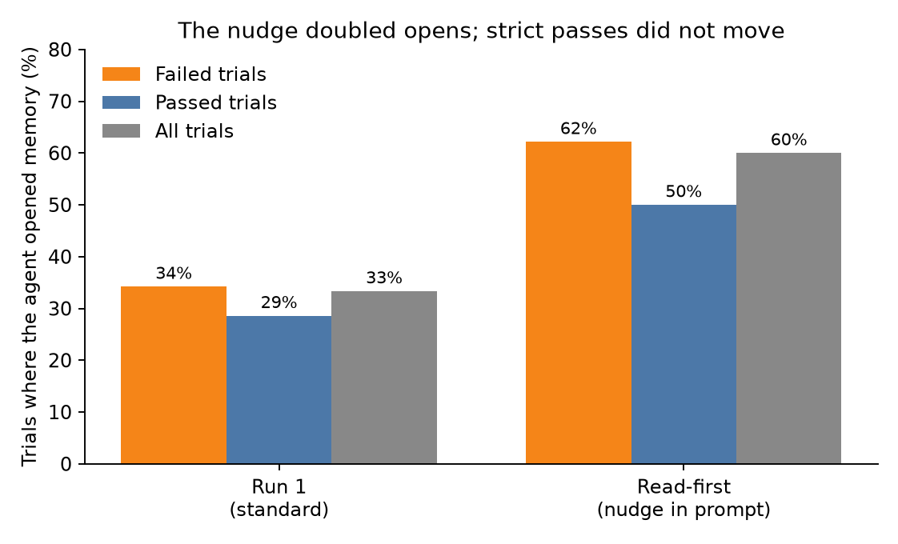
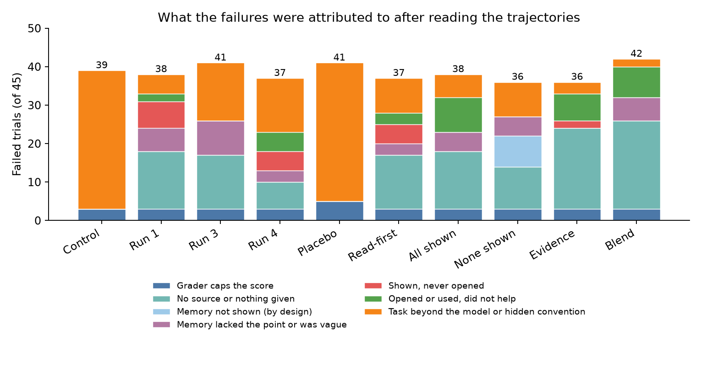

# Failure analysis of the FrontierMemory trials

We ran 15 FrontierMemory tasks under ten conditions, 45 trials each. Memory helped on one task. This report goes through the 385 trials that did not pass and asks why each one failed: did memory exist, did it reach the agent, did the agent use it, or was something else going on that no memory could have changed?

**Short version.** We sorted the failures twice. The first pass used only per-trial summaries and left 155 trials undeterminable. The second pass read the raw trajectories, which we recovered from the VM disk on Nov 16, and left none undeterminable. After the second pass, 152 of the 385 failures are cases where the grader caps the score or the corpus had nothing for the task, and 135 look like the task being beyond the agent or turning on a convention the prompt does not state. Memory is involved in 90: 37 where it lacked the point or was too vague to find, 19 where a relevant point was shown but never opened, and 34 where the agent opened or applied it and still failed (12 of them applied it correctly and failed downstream, 12 followed it and were made worse). A further 8 were by design: the memory had the content and the arm showed none of it. The memory reached the agent in every arm that was meant to show it (the read-first nudge sentence is the one item we could not confirm); delivery was not what failed.

**What this pass is and is not.** Sections 1 to 8 describe the first pass and are kept as written, with notes where the trajectories changed an answer. Section 9 gives the second pass and supersedes the first pass's counts. The trajectories show what the agent did, but they hold no saved reasoning text, so whether the agent "used" a memory is often inferred from what it did next. The evidence grade on each trial says which. The raw data stay in a private directory; they come from a gated corpus and are not in this repository.

## 1. How we sorted the failures

A trial fails when the final state of the task does not satisfy the verifier. Memory can change that only by changing what the agent does. So each failure gets four questions, in this order:

1. Could any memory have changed the outcome? Grader, environment, capability and infrastructure problems come first.
2. If so, did the memory contain the needed information?
3. Did it reach the agent, or was it reachable?
4. Did the agent use it correctly?

The first question answered "no" (or "can't tell") gives the trial's primary bucket. Each trial gets exactly one, plus secondary tags for other problems we could see. We fixed the buckets and the assignment rules in `TAXONOMY.md` before reading any trial, so the per-arm analysts could not tune them to the results.

```mermaid
flowchart LR
  A[Past runs in the corpus] --> B[Memory generated]
  B --> C[Memory file contents]
  C --> D[Copied into the task container]
  D --> E[Shown in the first prompt]
  E --> F[Agent opens it]
  F --> G[Agent applies it]
  G --> H[Output in the right place]
  H --> I[Verifier scores it]
  I --> J[Strict reward: all checks or nothing]
```

Every arrow is a place the chain can break. The first half (corpus to prompt) is what the memory arms differ in. The second half is the same for all ten arms, which is why a control with no memory still fails most of the time.

Each assignment also carries an evidence grade, so a table that looks complete cannot hide how much of it is guesswork:

- Observed (O): a log, file or score shows it directly.
- Paired (P): shown by comparing with the control or with the other attempts at the same task.
- Inferred (I): reasoned from the task, the arm and the scores, with no trial-level record.
- Unknown (U): the retained evidence cannot decide, so the trial is filed as undeterminable (D1).

## 2. The overall picture

The bars show what the 385 failed trials were attributed to, arm by arm. The colors group the buckets:

| Group | Trials | What it means |
|---|---|---|
| Grader caps the score | 32 | The task's own reference solution scores below 1, so a strict pass is not defined for these trials |
| No source, or nothing given | 106 | The corpus has no related run, or the arm gave the task nothing |
| Memory not shown (by design) | 30 | None-shown arm only: the memory was on disk, not advertised |
| Task beyond the model (inferred) | 59 | What is left after ruling out the others; not directly observed |
| Memory used, still failed | 3 | Agent read the right memory and still fell short |
| Cannot tell from retained logs | 155 | Needs the trajectory or the memory text |

Two things stand out. The no-memory control has the fewest undeterminable trials (6), because with no memory there is less to ask about. And the arms that look most different in the chart (none-shown, evidence) look different mostly because of how the analysts could label them: none-shown defaults to "not shown", and the evidence arm's records could be checked against the task text.

The pass counts barely differ. Out of 45 trials: control 6, run 1 7, run 3 4, run 4 8, placebo 4, read-first 8, all shown 7, none shown 9, evidence 9, blend 3.

Six tasks never passed in any arm, in 30 trials each: Eurogrid, the ChatGPT proposal task, both awilix tasks, customer delivery and DAPT. Three more pass at most twice in 30 trials: partnership contract once, cookie store and the EnterpriseOps Teams task twice each. The tasks that pass more often are Word2Vec, EnterpriseOps CSM and marketing content gap, with a few passes on cattrs and the APEX tasks.

## 3. What we found

### Grader and corpus limits

**Eurogrid.** This is an LLM-judged task with six rubric checks. Its reference solution scores 0.8333 under our setup. All 30 trials across the ten arms score exactly 0.8333 as well. A strict pass is out of reach for this task whatever the memory says. This is the cleanest case in the data, and it accounts for 30 of the 32 grader-capped trials we could confirm by observation.

**Awilix.** The task tests a release-tier change and has a separate preference check. Take trial `awilix-release-tier-explicit__2XjMqa5` in run 1. Its functional tests score 0.958, the same as the passing reference. Its preference check scores 0.0. The needed fact is "internal release tier 7 means bump the root `package.json` from 12.0.5 to 12.1.0", and the instruction never states it. The corpus has no run related to this task, so no generated memory could have supplied it. The control scores the same 0.48 on all three attempts. Run 1 and the placebo land in the same place, and so does read-first, where the agent opened memory in 4 of 6 trials.

Customer delivery and cattrs look the same from the outside. In cattrs, most failed trials pass 76 of 77 checks (partial 0.987) and miss a preference the instruction does not state: public API changes need documentation, a runnable example and a changelog entry. The corpus has no related run for cattrs either. These are near misses where the missing piece is a convention the task never states.

The dot plot shows each failed trial's share of checks passed. Notice how many tasks have tight clusters at the same value, for control and for the memory arms: Eurogrid at 0.83, Teams at 0.75, CSM at 0.75, awilix at 0.48. When a task fails with the same score every time, regardless of arm, the cause is a fixed property of the task and its checker, not of what the agent was shown. The tasks with spread (DAPT, partnership, marketing, cookie store) are the ones where the agent's work varies and where memory had room to matter.

### Opening memory (read-first against run 1)

In run 1, the agent opened memory in 15 of 45 trials (33%). The read-first arm adds one sentence to the system prompt telling the agent to check saved memory and open anything relevant.

It worked as a nudge: memory was opened in 27 of 45 trials (60%), and among failed trials the rate went from 34% to 62%. Strict passes went from 7 to 8. On awilix, opens went from 0 of 6 to 4 of 6, and the preference check stayed at 0.0 in all six failures. The agent read the memory and the memory did not contain the fact.

The partnership contract task shows the same thing from another angle. In read-first, all three attempts opened memory at turns 0 to 3 and scored 0.125 to 0.25, no better than the control. Memory that is opened but holds nothing about the task adds a read and changes nothing.

We cannot say what the run-1 memory says. It is one skill, `agent-evals/eval-task-families`, with reference files named for task families (analysis-mcp, workflow-automation, swe-repo, pcap). The file names suggest content, but the text is on the unreachable disk.

### Opened against not opened

The two arms with an access log (run 1 and read-first, 90 trials together) let us compare trials where the agent opened memory with trials where it did not. Without trajectories this is the closest we can get to asking whether reading memory helped, and the naive comparison is misleading.

Opened trials score higher against the control. Their partial credit is 0.124 above the control's average for the same task, against 0.030 for trials that did not open memory. Read that way, opening looks like it helps.

The agent chooses when to open memory, though, and it opens more on some tasks than others, so the two groups are not the same mix of tasks. Comparing within the same task and arm removes that: across the 16 task-and-arm cells that have both opened and unopened trials, opened trials score 0.085 lower on average. A permutation test (5,000 shuffles of the opened label within each cell) gives p = 0.90 that opening is better. Strict passes are 6 of 42 when opened and 9 of 48 when not.

So these data give no evidence that reading memory helped, and they cannot show that it hurt: the cells are small, and the agent may open memory when it is already struggling. The signs also mix by task. Within a task, opened trials did better on DAPT (0.79 against 0.43 and 0.57 in run 1) and cookie store (0.99 and 0.83 against 0.70 in read-first), and worse on marketing in run 1 (0.55 against 1.0 twice), market share in run 1 (0.0 twice against 1.0 once) and CSM in read-first (0.75 against 1.0 twice). `opens_analysis.py` reproduces the numbers.

### Word2Vec

Word2Vec asks the agent to write a function that goes in a particular place with a particular name. In the control and the placebo, 6 of 6 trials score exactly 0.0, and the pipeline audit notes that most gate failures wrote no `/workspace/solution.py` (the official prompt names no path). Every arm that gave the agent real memory or real past runs scores between 0.17 and 1.0. Run 1 scored 0.83, 1.0 and 1.0. The evidence arm passed 3 of 3: the past runs it was given include a passing one that shows `/workspace/solution.py` and the `task_func` signature.

The placebo is what makes this credible. It has the same number of files, the same file sizes, and the same prompt shape, filled with text from Moby-Dick. It scored 0 of 3. So this is not an effect of having a longer, memory-shaped prompt.

Even here we are inferring the mechanism. We do not know which check the remaining failures miss, and the three Word2Vec failures that scored about 0.83 are marked "memory used, still failed" at the inferred grade only.

### All shown and none shown

The all-shown arm puts every memory file in the system prompt. The none-shown arm leaves the files on disk and mentions nothing. Strict passes were 7 and 9, against 7 for run 1 and 6 for the control.

None-shown behaves like a second control. It matches the control's pass count on 11 of 15 tasks. Total agent minutes were 781 against the control's 769, and input tokens 153M against 154M. The sign-flip test on per-task differences gives p = 0.50 against the control and 0.75 against run 1. Its +3 over control is cattrs +2, Word2Vec +1, CSM +1, partnership −1. Two cells look different from the control (cattrs 2 of 3, and an artifact from Word2Vec in all three attempts), and the agent may have found the files by exploring, but no retained log shows it.

All-shown cost 8% more input tokens than the control (166.5M against 154.3M), and no failed trial came near its time limit (the longest used 56%). It loses a pass that some other arm had on six tasks and gains on three, which nets to zero against run 1. Marketing, partnership and cookie store are candidates for a distraction effect, but nothing here confirms one.

Ten all-shown trials stalled on the model server and were rerun. The counted trials are the clean reruns, and none overlaps a logged stall window.

### What the evidence arm staged

The evidence arm skips memory generation and drops the "related" raw runs into `/tmp/hermes/records`. We scanned the staged files for task-specific strings to see what the agent was actually given.

For APEX market-share it staged 19 records and none is the same task; they are other Brightpath tasks. For seat-surplus, 19 and none. For cookie store, the one staged record is an EnterpriseOps CSM trial. For the AutomationBench tasks, each got 45 files and 15 of them are its own. Only 4 tasks got nothing at all. So the staging rule (30% overlap with the task's opening, or the opening naming the repository or family) is much looser than "runs on this task."

Where the right records were staged, the arm sometimes did no better. Marketing's passing record shows the notification target and the exact values (advocacy 88, decision 74). The arm passed 2 of 3, the same as control, and we cannot tell whether the agent found the record among 45 files totalling 17.9 MB.

EnterpriseOps CSM went 3 of 3 here, but control passed it 2 of 3 and all arms together pass it 19 of 30. That is inside the noise.

### Blend

Blend rewrites each task description to carry run 1's memory (12 of 15 changed, 2 unchanged, 1 left out after its rewrite failed twice). Strict passes on the 14 compared tasks fell from 7 (run 1) to 3. The whole drop is marketing and Word2Vec, each 2 of 3 to 0 of 3. Pooled that is p of about 0.03, but we picked those two tasks after seeing the result, so we do not treat it as evidence of harm. No task went up on strict. Mean hidden-test share was 0.667 against run 1's 0.681 and the control's 0.584.

On Word2Vec, blend scored exactly 0.833 on all three attempts, where the control scored 0.0. DAPT rose to 0.762 against run 1's 0.595 and control's 0.405 but stayed 0 of 3 strict. For the tasks where the corpus has no related run, rewrites that added 5 to 15 sentences changed nothing measurable: awilix preference stayed 0.0 in 6 of 6, and cattrs stayed at 76 of 77.

### Run 3 on EnterpriseOps CSM

Run 3 passed EnterpriseOps CSM 0 of 3, where the control, run 1 and run 4 each passed 2 of 3. All three run-3 failures score 0.75, the same signature as the one failure in each of the other arms. Tokens and minutes are in range, no serving incident overlaps, and the decision log records no 5xx errors for the run. Across the other arms CSM passes about 70% of the time. A 0 of 3 for one named arm has a probability of about 3%, and about 25% that some arm out of ten shows it. We read it as noise. We cannot rule out a memory effect without run 3's memory text.

## 4. Arm by arm

| Arm | Failed | Grader caps | No source or nothing given | Not shown | Beyond the model (inferred) | Used, still failed | Cannot tell |
|---|---|---|---|---|---|---|---|
| Control | 39 | 3 | 0 | 0 | 30 | 0 | 6 |
| Run 1 | 38 | 3 | 15 | 0 | 0 | 1 | 19 |
| Run 3 | 41 | 3 | 12 | 0 | 2 | 0 | 24 |
| Run 4 | 37 | 3 | 14 | 0 | 0 | 2 | 18 |
| Placebo | 41 | 5 | 0 | 0 | 16 | 0 | 20 |
| Read-first | 37 | 3 | 11 | 0 | 0 | 0 | 23 |
| All shown | 38 | 3 | 15 | 0 | 0 | 0 | 20 |
| None shown | 36 | 3 | 0 | 30 | 0 | 0 | 3 |
| Evidence | 36 | 3 | 21 | 0 | 11 | 0 | 1 |
| Blend | 42 | 3 | 18 | 0 | 0 | 0 | 21 |

The columns reflect how each analyst could label a trial, not only how the trials failed. The control has no "no source" trials because with no memory there is nothing to be missing, so those same failures land under "beyond the model". The none-shown arm's 30 "not shown" trials are the default for an arm that shows nothing, and each carries a note on what bucket the control analysis would use. Use the pass counts and the paired scores in section 3 to compare arms.

## 5. What this says about memory

What the data supports: on these 15 tasks, with this local model and Hermes' skill-based memory, the main limit is not delivery. Six tasks fail for reasons that do not involve memory (a grader that tops out below 1, or a hidden preference that nothing in the corpus teaches). The tasks where the agent's work varies are the ones where memory had room to matter, and there we see one clear effect (Word2Vec) and several differences inside noise.

What it does not support: a claim that memory could not help. The corpus has related runs for only some tasks, and for those the memory text, which we cannot read, may have been too generic to help. A better-built memory is a different experiment.

## 6. What we do not know

- **The 155 undeterminable trials are now classified (section 9).** The first-pass text below is kept for the record. 57 of the 385 second-pass labels are still inferences, not observations; section 9 says which.
- **The "beyond the model" labels are mostly observed now.** Of the 128 A3 labels after the second pass, 103 are observed in the trajectory, 14 rest on a paired comparison and 11 are inferred.
- **"No source" is approximate.** The corpus coverage count matches on prompt similarity. For the three AutomationBench tasks it returns the same counts, which looks like matching on a shared preamble, so we did not use it for them and filed those trials as undeterminable.
- **The early stops need a look.** On seat-surplus, 14 of 27 failed trials ended in under 3 minutes while its passes took 11 to 18. Teams has a median of 1.6 minutes. Those may be the agent giving up early, a tool problem or a prompt problem. We have not seen one.
- **The APEX judge is not validated.** Three judges are named in the sources (Gemini 2.5 Flash in the task file, GPT-5.6 Sol in the CLI, Claude Opus 5.5 in our runs). Agreement was shown on correct reference answers only. On market-share and seat-surplus every failed trial scores exactly 0.0, which looks binary, so we cannot tell a wrong answer from a judge error.

## 7. Problems we found in our own records

The analysis surfaced several mismatches. We list them here and have fixed the ones that sit in this report's own files.

- We first wrote that seven tasks never pass. It is six. Corrected in `TAXONOMY.md` (amendment 1).
- We first wrote that the evidence arm gave nothing to 8 of 15 tasks. That is the corpus coverage count. The arm staged files for 11 of 15 tasks, though many are other tasks' runs (amendment 3).
- `results/pipeline-audit.md` (line 11) says a counted control trial, `HJvLDqW`, passed cattrs 77 of 77. The trial exists and scored 77 of 77, but it sits in the pilot control job (`fm-tasks-control-pilot2`), not in the counted control run. The counted control run has no cattrs pass, which matches its summary file. The sentence in the audit file is mislabelled; we have not edited it.
- The assignment order puts "nothing shown" (B7) before "no source" (B1), while the stated principle asks whether the information existed first. The none-shown analyst followed the rule. Under the principle, about 17 of its 30 "not shown" trials would be "no source" instead. The second pass checked this: 11 of the 30 became no source (the memory holds nothing about what was missed), 8 stayed not shown, 8 became beyond the model and 3 became generation-lost.
- DAPT's partial scores are multiples of 1/14, but the oracle check ran 37 cases. We did not reconcile the two.
- Awilix partial credit never reaches 1 even for the passing reference, because a skipped test counts as not passed. Read 0.479 as "functional work done, preference missed."

## 8. What is still open

The trajectory pass is done (section 9). These questions are still open:

1. Whether the nudge sentence in the read-first arm reached the model. It is in each trial's config, not in the saved prompt, and Hermes appends it at request time. The jump in opens from 15 of 45 to 27 of 45 suggests it did. The saved files cannot show it.
2. Whether the 19 trials where a relevant point sat unopened would have passed had the agent opened it. Section 10 reports a follow-up run for 17 of them. It found no reliable gain, with only 3 attempts per task and memory.
3. B1 against B3 on the trials where the corpus has related runs. We did not read the gated corpus, so those labels rest on the coverage counts in `TASK-LEVEL.md`.
4. The APEX judge, as in section 6.

## 9. Second pass: reading the trajectories

**Method.** One agent per arm read every failed trial's trajectory, saved prompts, session log and verifier output, and answered the same four questions plus a fifth ("if memory is not the cause, what is?"). The instructions are in `TRACES-BRIEF.md`. The data were copied out of the VM disk on Nov 16. The disk was booted with writes discarded, and its size and modification time were identical before and after. We checked the totals against each agent's report, and spot-checked three claims against the raw files: the four none-shown trials that opened the staged memory folder, the three run 3 Teams trials that all omitted `source` in `create_call`, and the pilot-versus-counted location of the cattrs control trial.

**What changed.** 194 of the 385 labels changed. All 155 undeterminable trials were assigned: 67 to beyond the model, 28 to generation-lost, 17 to shown-but-never-opened, 11 to no source, 10 to applied-correctly-still-failed, 8 to read-but-not-applied, 6 to misapplied, and the rest to a handful of other buckets. Evidence is observed on 295 trials, paired on 33 and inferred on 57. None is left undeterminable.

| After the second pass | Trials |
|---|---|
| Beyond the model, or a convention the prompt does not state (A3, A7) | 135 |
| No source, or the arm gave nothing (B1, B2) | 120 |
| Memory lacked the point or was too vague (B3, B4) | 37 |
| Opened or applied, and it did not help (C2, C4, C5, C6) | 34 |
| Grader caps the score (A1) | 32 |
| Relevant memory shown, never opened (C1) | 19 |
| Memory had it, arm showed none (B7) | 8 |

**What the trajectories showed, arm by arm.**

- **Control (39 failures).** No exception, timeout or serving fault in any trial. The 27 trials that were an unexplained remainder have named mechanisms: conventions the prompt does not state while the functional tests pass (the awilix version bump, the cattrs documentation example), conflicting sources resolved the wrong way, plain functional bugs, and DAPT counting conventions. On market-share the agent used raw ARR. Two seat-surplus attempts quit after a minute of local search and never used the file tools their sibling used.
- **Run 1, run 3, run 4.** The skill index was in the system prompt in every trial. The playbook was opened in 23 of 45 run 4 trials (18 of its 37 failures), 11 of the 41 failed run 3 trials, and, by the access log, memory was opened in 15 of 45 run 1 trials. In run 3, six failed trials had the relevant point in a playbook they never opened. When a playbook was opened it was used (Word2Vec, DAPT attempt 3 in run 4). In run 3 the stored Teams lesson is wrong, not missing: it blames the call state, while all three attempts omitted `source`. In run 4, seven trials that the first pass called memory-missing (cookie store, awilix) failed hidden functional tests independently of the missing preference.
- **Placebo.** The memory block and index reached the agent in every trial and the unrelated text did not change what failed. In two Word2Vec trials the agent opened the unrelated text and used it as its training data. Those trials still failed first because the prompt names no `/workspace/solution.py`, the file the verifier loads. The same missing path fails control Word2Vec trials too.
- **Read-first.** The nudge sentence is not in the saved prompt; it is in the config of all 45 trials, and Hermes adds it at request time. Memory was opened in 27 of 45 trials, 13 of them on the first turn. All three partnership trials followed run 1's stored instruction to correct the amount to $450,000, where the verifier expects $750,000.
- **All shown.** All 13 memory files were in the system prompt in 45 of 45 trials, about 16,000 tokens more per request than control. The agent's reasoning quotes the memory in 30 of the 38 failures. The largest prompt reached 189,000 tokens against a 262,144-token window, with no overflow errors and two compacted trials. No trial is attributed to context pressure. The failures sit where the memory was silent (the APEX tasks never read mail), two-sided (partnership) or under-specified (DAPT, Word2Vec, Teams).
- **None shown.** The "nothing shown" arm was not fully memory-free. The staged folder is `/tmp/hermes/memories`; four of 45 trials opened it (one market-share failure, two failed Word2Vec attempts and the Word2Vec pass). The Word2Vec prompt says "prior implementations", which led the agent there. The two failures followed the memory's path and signature and then raised an error on all-stop-word input, where the memory only says to guard the edge case.
- **Evidence.** In Teams the two failing trials never opened the staged records; a passing record held the missing `source` field, and the passing sibling found it. In partnership and DAPT the agent copied wrong answers from records that had themselves failed. The pointer to the records is in the config, not the saved prompt, so exposure was judged from what the agent did.
- **Blend.** The rewritten text reached every agent and, where it carried a specific point, was often misused. On the ChatGPT proposal task an added "SOP governs" line led two agents to discard a note that superseded it. On Word2Vec an either-or guard sentence led all three agents to raise an error where the hidden test needs a model returned. On Teams the caller-identity note reached all three agents and none set `source`. Most of the added APEX text was harness boilerplate. The rewriter's input file is not in the copy, so we could only match the added sentences against run 1's memory.

**What this says.** Memory was delivered and the agent saw it. Where it failed to help, the usual reason was that the memory lacked the failed point, was ambiguous or was wrong, or the point sat in a file the agent did not open. The first-pass answer to "was memory delivered" was mostly inference; it is now observed for the arms that show memory. The opened-against-not-opened result in section 3 is unchanged.

**Limits.** The agents did not read the gated corpus, so B1 against B3 rests on the coverage counts. No reasoning text is saved, so "applied" and "misapplied" are inferred from behaviour; of the 12 misapplied trials, 4 are observed, 5 paired and 3 inferred. The Teams call failure is inferred, because the verifier gives no reason text. One of the agents ran another agent's script by accident in a shared scratch folder; we checked that file's counts and they match its agent's report.

Files for this section: `TRACES-BRIEF.md`, `traces/traces-<arm>.md` and `.jsonl` (one pair per arm), `traces/traces-all.json` and `traces_figure.py`.

## 10. Follow-up: forcing the unread note into the prompt

Section 9 left one question open: in the trials where a relevant note was shown by index and never opened, would reading it have changed the result? We reran those tasks with the relevant note files placed in the system prompt, so the agent could not skip them. This is an exploratory run, reported separately from the counted results.

**Setup.** Same model, harness, effort and grader as the main study; 3 attempts per task. For run 1 the injected files were the skill file plus the matching reference (seat surplus: the paths and analysis-tool references; DAPT: the pcap reference; Teams: the office-tool reference). Run 4's memory is small, so all of its files were injected for seat surplus, DAPT and the marketing task. Each trial's `forceopen-report.json` records the files injected (3 to 7 files, about 4,000 tokens or more) and the memory hash. The study disk was only read; the VM ran on a copy-on-write overlay.

**Results.** Passes out of 3 attempts, next to the same task in the original arms:

| Task | Memory | Forced open | Original arm | Control | All shown |
| --- | --- | --- | --- | --- | --- |
| Seat surplus | Run 1 | 1/3 | 0/3 | 0/3 | 1/3 |
| DAPT | Run 1 | 0/3 | 0/3 | 0/3 | 0/3 |
| Teams (2725d17f) | Run 1 | 0/3 | 0/3 | 0/3 | 1/3 |
| Seat surplus | Run 4 | 1/3 | 1/3 | 0/3 | 1/3 |
| DAPT | Run 4 | 0/3 | 0/3 | 0/3 | 0/3 |
| Marketing content gap | Run 4 | 2/3 | 1/3 | 2/3 | 1/3 |

Run 1 forced open passed 1 of 9 trials against 0 of 9 in its original arm; run 4 passed 4 of 9 against 2 of 9. Every difference is one trial in one task, which is inside the spread between identical arms (the marketing task alone ranges from 0 of 3 to 3 of 3 across arms with unrelated memory). Putting the note in front of the agent did not rescue DAPT in either memory (0 of 6 here, and it has never passed in any of the 12 arms), and it did not rescue Teams. The one clear improvement over control, run 1 on seat surplus, is a single pass and matches what the all-shown arm and run 4 already produced.

**Reading.** Not opening the note was not what kept these trials from passing. Where the note was forced in, the same tasks failed at about the same rate, which fits the earlier finding that the notes either lacked the failed point or the task failed for reasons memory does not reach (DAPT's grader cap, conventions the prompt does not state). The evidence for notes that help is the same weak signal as before: a handful of single-trial gains.

**Limits.** Three attempts per task and memory cannot detect a gain smaller than a full task's worth of passes. The all-shown arm had already injected every run 1 file, so for run 1 this run adds only the narrower injection, and for run 4 it is the first forced exposure. The two evidence-arm Teams trials (unread records, not notes) were not rerun. Run 4's first launch stopped after one trial because the harness could not match a trial folder name that Harbor shortens to 32 characters; the fix is in `915059d`, and the job was resumed so the first seat-surplus trial was kept.

Files for this section: `official/fm_local/forceopen_hermes.py`, `official/vm/run-forceopen.sh`, and the summaries and audits `results/official/summary-fm-tasks-forceopen-run1.jsonl`, `...run4.jsonl` with matching `audit-` files.

## Files

- `TAXONOMY.md`: buckets, assignment rules, evidence grades, amendments.
- `TASK-LEVEL.md` and `task-level.json`: per-task verifier, reference score, corpus coverage, score profile.
- `arm-<name>.md` and `arm-<name>.jsonl`: one analysis and one per-trial table for each arm (runs 3 and 4 have one each).
- `all-failures.json`: the 385 rows merged.
- `figures.py` and `figures/`: the plots in this report.
- `TRACES-BRIEF.md`, `traces/` and `traces_figure.py`: the second pass (section 9).
