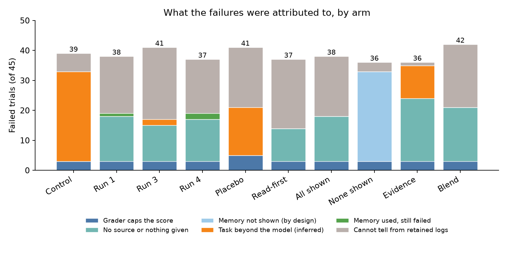
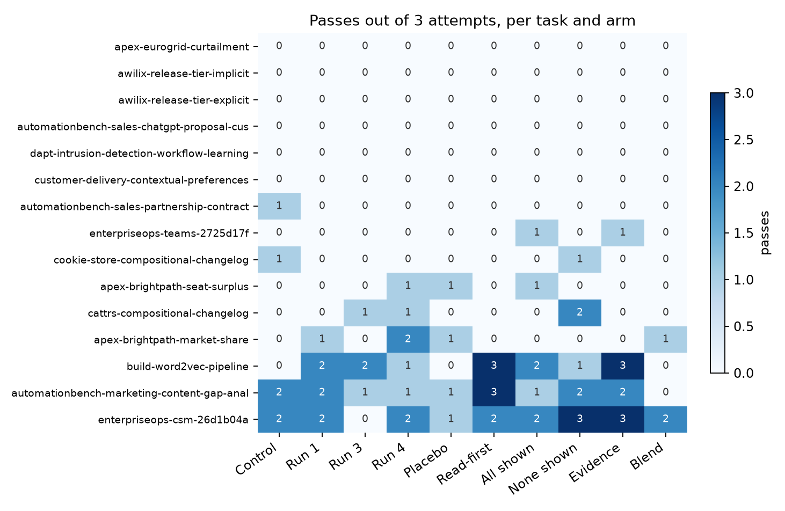
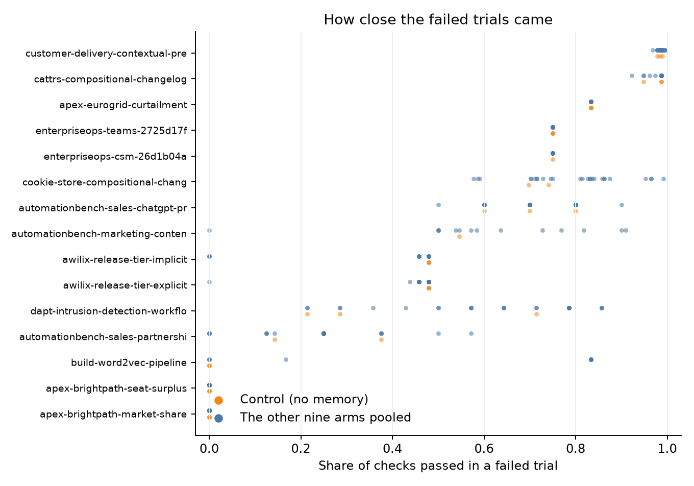

# Failure analysis of the FrontierMemory trials

We ran 15 FrontierMemory tasks under ten conditions, 45 trials each. Memory helped on one task. This report goes through the 385 trials that did not pass and asks why each one failed: did memory exist, did it reach the agent, did the agent use it, or was something else going on that no memory could have changed?

**Short version.** More than a third of the failures (138 of 385) are ones where the grader caps the score or the corpus had nothing to learn from. Another 155 cannot be explained from the logs we kept. Only 3 trials show the agent using memory correctly and still failing. We found no failure that we can say a better-delivered memory would have fixed.

The raw trial directories (agent trajectories, saved prompts, verifier logs) sit on a compute node's local disk, and that node has been down since Nov 14. Everything below comes from what we have on the login host: per-trial summaries, partial-credit scores, audit files, memory-access logs for two arms, serving incidents, the task sources and the corpus. Where a conclusion needs a trajectory we say so and count the trial as undeterminable. Section 6 lists what that costs us.

## 1. How we sorted the failures

A trial fails when the final state of the task does not satisfy the verifier. Memory can change that only by changing what the agent does. So each failure gets four questions, in this order:

1. Could any memory have changed the outcome? Grader, environment, capability and infrastructure problems come first.
2. If so, did the memory contain the needed information?
3. Did it reach the agent, or was it reachable?
4. Did the agent use it correctly?

The first question answered "no" (or "can't tell") gives the trial's primary bucket. Each trial gets exactly one, plus secondary tags for other problems we could see. We fixed the buckets and the assignment rules in `TAXONOMY.md` before reading any trial, so the per-arm analysts could not tune them to the results.

```mermaid
flowchart LR
  A[Past runs in the corpus] --> B[Memory generated]
  B --> C[Memory file contents]
  C --> D[Copied into the task container]
  D --> E[Shown in the first prompt]
  E --> F[Agent opens it]
  F --> G[Agent applies it]
  G --> H[Output in the right place]
  H --> I[Verifier scores it]
  I --> J[Strict reward: all checks or nothing]
```

Every arrow is a place the chain can break. The first half (corpus to prompt) is what the memory arms differ in. The second half is the same for all ten arms, which is why a control with no memory still fails most of the time.

Each assignment also carries an evidence grade, so a table that looks complete cannot hide how much of it is guesswork:

- Observed (O): a log, file or score shows it directly.
- Paired (P): shown by comparing with the control or with the other attempts at the same task.
- Inferred (I): reasoned from the task, the arm and the scores, with no trial-level record.
- Unknown (U): the retained evidence cannot decide, so the trial is filed as undeterminable (D1).

## 2. The overall picture

The bars show what the 385 failed trials were attributed to, arm by arm. The colors group the buckets:

| Group | Trials | What it means |
|---|---|---|
| Grader caps the score | 32 | The task's own reference solution scores below 1, so a strict pass is not defined for these trials |
| No source, or nothing given | 106 | The corpus has no related run, or the arm gave the task nothing |
| Memory not shown (by design) | 30 | None-shown arm only: the memory was on disk, not advertised |
| Task beyond the model (inferred) | 59 | What is left after ruling out the others; not directly observed |
| Memory used, still failed | 3 | Agent read the right memory and still fell short |
| Cannot tell from retained logs | 155 | Needs the trajectory or the memory text |

Two things stand out. The no-memory control has the fewest undeterminable trials (6), because with no memory there is less to ask about. And the arms that look most different in the chart (none-shown, evidence) look different mostly because of how the analysts could label them: none-shown defaults to "not shown", and the evidence arm's records could be checked against the task text.

The pass counts barely differ. Out of 45 trials: control 6, run 1 7, run 3 4, run 4 8, placebo 4, read-first 8, all shown 7, none shown 9, evidence 9, blend 3.

Six tasks never passed in any arm, in 30 trials each: Eurogrid, the ChatGPT proposal task, both awilix tasks, customer delivery and DAPT. Three more pass at most twice in 30 trials: partnership contract once, cookie store and the EnterpriseOps Teams task twice each. The tasks that pass more often are Word2Vec, EnterpriseOps CSM and marketing content gap, with a few passes on cattrs and the APEX tasks.

## 3. What we found

### Grader and corpus limits

**Eurogrid.** This is an LLM-judged task with six rubric checks. Its reference solution scores 0.8333 under our setup. All 30 trials across the ten arms score exactly 0.8333 as well. A strict pass is out of reach for this task whatever the memory says. This is the cleanest case in the data, and it accounts for 30 of the 32 grader-capped trials we could confirm by observation.

**Awilix.** The task tests a release-tier change and has a separate preference check. Take trial `awilix-release-tier-explicit__2XjMqa5` in run 1. Its functional tests score 0.958, the same as the passing reference. Its preference check scores 0.0. The needed fact is "internal release tier 7 means bump the root `package.json` from 12.0.5 to 12.1.0", and the instruction never states it. The corpus has no run related to this task, so no generated memory could have supplied it. The control scores the same 0.48 on all three attempts. Run 1 and the placebo land in the same place, and so does read-first, where the agent opened memory in 4 of 6 trials.

Customer delivery and cattrs look the same from the outside. In cattrs, most failed trials pass 76 of 77 checks (partial 0.987) and miss a preference the instruction does not state: public API changes need documentation, a runnable example and a changelog entry. The corpus has no related run for cattrs either. These are near misses where the missing piece is a convention the task never states.

The dot plot shows each failed trial's share of checks passed. Notice how many tasks have tight clusters at the same value, for control and for the memory arms: Eurogrid at 0.83, Teams at 0.75, CSM at 0.75, awilix at 0.48. When a task fails with the same score every time, regardless of arm, the cause is a fixed property of the task and its checker, not of what the agent was shown. The tasks with spread (DAPT, partnership, marketing, cookie store) are the ones where the agent's work varies and where memory had room to matter.

### Opening memory (read-first against run 1)

In run 1, the agent opened memory in 15 of 45 trials (33%). The read-first arm adds one sentence to the system prompt telling the agent to check saved memory and open anything relevant.

It worked as a nudge: memory was opened in 27 of 45 trials (60%), and among failed trials the rate went from 34% to 62%. Strict passes went from 7 to 8. On awilix, opens went from 0 of 6 to 4 of 6, and the preference check stayed at 0.0 in all six failures. The agent read the memory and the memory did not contain the fact.

The partnership contract task shows the same thing from another angle. In read-first, all three attempts opened memory at turns 0 to 3 and scored 0.125 to 0.25, no better than the control. Memory that is opened but holds nothing about the task adds a read and changes nothing.

We cannot say what the run-1 memory says. It is one skill, `agent-evals/eval-task-families`, with reference files named for task families (analysis-mcp, workflow-automation, swe-repo, pcap). The file names suggest content, but the text is on the unreachable disk.

### Word2Vec

Word2Vec asks the agent to write a function that goes in a particular place with a particular name. In the control and the placebo, 6 of 6 trials score exactly 0.0, and the pipeline audit notes that most gate failures wrote no `/workspace/solution.py` (the official prompt names no path). Every arm that gave the agent real memory or real past runs scores between 0.17 and 1.0. Run 1 scored 0.83, 1.0 and 1.0. The evidence arm passed 3 of 3: the past runs it was given include a passing one that shows `/workspace/solution.py` and the `task_func` signature.

The placebo is what makes this credible. It has the same number of files, the same file sizes, and the same prompt shape, filled with text from Moby-Dick. It scored 0 of 3. So this is not an effect of having a longer, memory-shaped prompt.

Even here we are inferring the mechanism. We do not know which check the remaining failures miss, and the three Word2Vec failures that scored about 0.83 are marked "memory used, still failed" at the inferred grade only.

### All shown and none shown

The all-shown arm puts every memory file in the system prompt. The none-shown arm leaves the files on disk and mentions nothing. Strict passes were 7 and 9, against 7 for run 1 and 6 for the control.

None-shown behaves like a second control. It matches the control's pass count on 11 of 15 tasks. Total agent minutes were 781 against the control's 769, and input tokens 153M against 154M. The sign-flip test on per-task differences gives p = 0.50 against the control and 0.75 against run 1. Its +3 over control is cattrs +2, Word2Vec +1, CSM +1, partnership −1. Two cells look different from the control (cattrs 2 of 3, and an artifact from Word2Vec in all three attempts), and the agent may have found the files by exploring, but no retained log shows it.

All-shown cost 8% more input tokens than the control (166.5M against 154.3M), and no failed trial came near its time limit (the longest used 56%). It loses a pass that some other arm had on six tasks and gains on three, which nets to zero against run 1. Marketing, partnership and cookie store are candidates for a distraction effect, but nothing here confirms one.

Ten all-shown trials stalled on the model server and were rerun. The counted trials are the clean reruns, and none overlaps a logged stall window.

### What the evidence arm staged

The evidence arm skips memory generation and drops the "related" raw runs into `/tmp/hermes/records`. We scanned the staged files for task-specific strings to see what the agent was actually given.

For APEX market-share it staged 19 records and none is the same task; they are other Brightpath tasks. For seat-surplus, 19 and none. For cookie store, the one staged record is an EnterpriseOps CSM trial. For the AutomationBench tasks, each got 45 files and 15 of them are its own. Only 4 tasks got nothing at all. So the staging rule (30% overlap with the task's opening, or the opening naming the repository or family) is much looser than "runs on this task."

Where the right records were staged, the arm sometimes did no better. Marketing's passing record shows the notification target and the exact values (advocacy 88, decision 74). The arm passed 2 of 3, the same as control, and we cannot tell whether the agent found the record among 45 files totalling 17.9 MB.

EnterpriseOps CSM went 3 of 3 here, but control passed it 2 of 3 and all arms together pass it 19 of 30. That is inside the noise.

### Blend

Blend rewrites each task description to carry run 1's memory (12 of 15 changed, 2 unchanged, 1 left out after its rewrite failed twice). Strict passes on the 14 compared tasks fell from 7 (run 1) to 3. The whole drop is marketing and Word2Vec, each 2 of 3 to 0 of 3. Pooled that is p of about 0.03, but we picked those two tasks after seeing the result, so we do not treat it as evidence of harm. No task went up on strict. Mean hidden-test share was 0.667 against run 1's 0.681 and the control's 0.584.

On Word2Vec, blend scored exactly 0.833 on all three attempts, where the control scored 0.0. DAPT rose to 0.762 against run 1's 0.595 and control's 0.405 but stayed 0 of 3 strict. For the tasks where the corpus has no related run, rewrites that added 5 to 15 sentences changed nothing measurable: awilix preference stayed 0.0 in 6 of 6, and cattrs stayed at 76 of 77.

### Run 3 on EnterpriseOps CSM

Run 3 passed EnterpriseOps CSM 0 of 3, where the control, run 1 and run 4 each passed 2 of 3. All three run-3 failures score 0.75, the same signature as the one failure in each of the other arms. Tokens and minutes are in range, no serving incident overlaps, and the decision log records no 5xx errors for the run. Across the other arms CSM passes about 70% of the time. A 0 of 3 for one named arm has a probability of about 3%, and about 25% that some arm out of ten shows it. We read it as noise. We cannot rule out a memory effect without run 3's memory text.

## 4. Arm by arm

| Arm | Failed | Grader caps | No source or nothing given | Not shown | Beyond the model (inferred) | Used, still failed | Cannot tell |
|---|---|---|---|---|---|---|---|
| Control | 39 | 3 | 0 | 0 | 30 | 0 | 6 |
| Run 1 | 38 | 3 | 15 | 0 | 0 | 1 | 19 |
| Run 3 | 41 | 3 | 12 | 0 | 2 | 0 | 24 |
| Run 4 | 37 | 3 | 14 | 0 | 0 | 2 | 18 |
| Placebo | 41 | 5 | 0 | 0 | 16 | 0 | 20 |
| Read-first | 37 | 3 | 11 | 0 | 0 | 0 | 23 |
| All shown | 38 | 3 | 15 | 0 | 0 | 0 | 20 |
| None shown | 36 | 3 | 0 | 30 | 0 | 0 | 3 |
| Evidence | 36 | 3 | 21 | 0 | 11 | 0 | 1 |
| Blend | 42 | 3 | 18 | 0 | 0 | 0 | 21 |

The columns reflect how each analyst could label a trial, not only how the trials failed. The control has no "no source" trials because with no memory there is nothing to be missing, so those same failures land under "beyond the model". The none-shown arm's 30 "not shown" trials are the default for an arm that shows nothing, and each carries a note on what bucket the control analysis would use. Use the pass counts and the paired scores in section 3 to compare arms.

## 5. What this says about memory

What the data supports: on these 15 tasks, with this local model and Hermes' skill-based memory, the main limit is not delivery. Six tasks fail for reasons that do not involve memory (a grader that tops out below 1, or a hidden preference that nothing in the corpus teaches). The tasks where the agent's work varies are the ones where memory had room to matter, and there we see one clear effect (Word2Vec) and several differences inside noise.

What it does not support: a claim that memory could not help. The corpus has related runs for only some tasks, and for those the memory text, which we cannot read, may have been too generic to help. A better-built memory is a different experiment.

## 6. What we do not know

- **155 trials are undeterminable.** Settling them needs the trajectories, the saved first prompt for each trial and the memory text for runs 1, 3 and 4. All sit on a VM disk on a compute node that has been down since Nov 14. A read-only probe job is queued for when it returns.
- **The 59 "beyond the model" labels are a residual.** They mean no other explanation fit, not that anyone watched the model fail. Only a trajectory turns them into observations.
- **"No source" is approximate.** The corpus coverage count matches on prompt similarity. For the three AutomationBench tasks it returns the same counts, which looks like matching on a shared preamble, so we did not use it for them and filed those trials as undeterminable.
- **The early stops need a look.** On seat-surplus, 14 of 27 failed trials ended in under 3 minutes while its passes took 11 to 18. Teams has a median of 1.6 minutes. Those may be the agent giving up early, a tool problem or a prompt problem. We have not seen one.
- **The APEX judge is not validated.** Three judges are named in the sources (Gemini 2.5 Flash in the task file, GPT-5.6 Sol in the CLI, Claude Opus 5.5 in our runs). Agreement was shown on correct reference answers only. On market-share and seat-surplus every failed trial scores exactly 0.0, which looks binary, so we cannot tell a wrong answer from a judge error.

## 7. Problems we found in our own records

The analysis surfaced several mismatches. We list them here and have fixed the ones that sit in this report's own files.

- We first wrote that seven tasks never pass. It is six. Corrected in `TAXONOMY.md` (amendment 1).
- We first wrote that the evidence arm gave nothing to 8 of 15 tasks. That is the corpus coverage count. The arm staged files for 11 of 15 tasks, though many are other tasks' runs (amendment 3).
- `results/pipeline-audit.md` (line 11) says a counted control trial, `HJvLDqW`, passed cattrs 77 of 77. The control summary file has no cattrs passes and that trial id appears in no summary file on this host. We have not changed that sentence; it needs a check against the original run.
- The assignment order puts "nothing shown" (B7) before "no source" (B1), while the stated principle asks whether the information existed first. The none-shown analyst followed the rule. Under the principle, about 17 of its 30 "not shown" trials would be "no source" instead.
- DAPT's partial scores are multiples of 1/14, but the oracle check ran 37 cases. We did not reconcile the two.
- Awilix partial credit never reaches 1 even for the passing reference, because a skipped test counts as not passed. Read 0.479 as "functional work done, preference missed."

## 8. Next steps once the disk is back

A trajectory-level pass would settle most of the 155. In order of value:

1. For each failed trial in the 8 arms with memory, read the saved first request and confirm what the model saw (exposure bucket checks).
2. Read the three run memories, then check whether any skill covers a failed task's missing piece (generation and specificity buckets).
3. For trials that opened memory and failed (15 in read-first, 13 in run 1), read the turn where the error was made and compare it with the turn of the first open (read-but-not-applied versus opened-too-late).
4. For seat-surplus and Teams early stops, read the last ten turns.
5. For the APEX tasks, read the judge's rationale on a sample of 0.0 scores.

## Files

- `TAXONOMY.md`: buckets, assignment rules, evidence grades, amendments.
- `TASK-LEVEL.md` and `task-level.json`: per-task verifier, reference score, corpus coverage, score profile.
- `arm-<name>.md` and `arm-<name>.jsonl`: one analysis and one per-trial table for each arm (runs 3 and 4 have one each).
- `all-failures.json`: the 385 rows merged.
- `figures.py` and `figures/`: the plots in this report.
