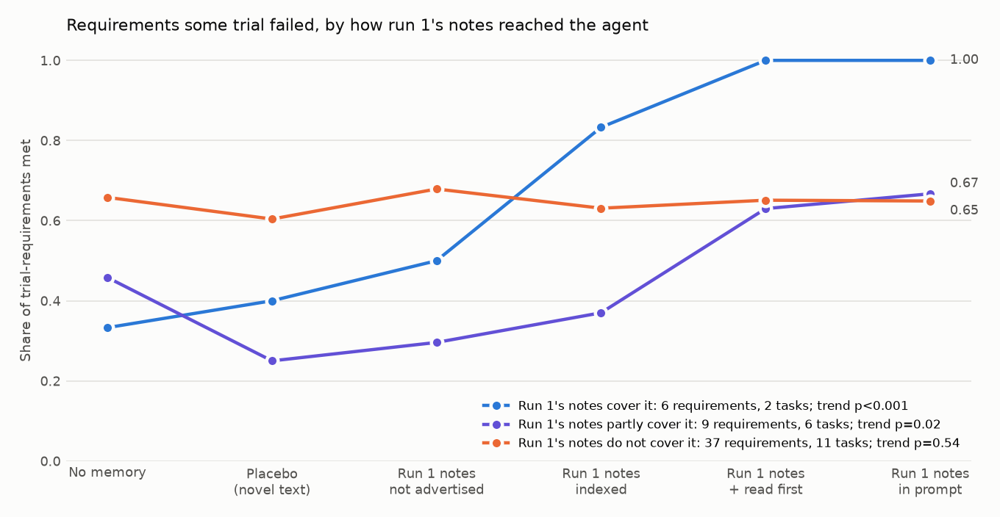

# FrontierMemory failure analysis: requirements, content and exposure (450 trials)

This report replaces `REPORT-v1.md`, which is kept as the record of the earlier analysis, and the two blog drafts built from it. It keeps what still holds from them and corrects what does not; section 8 lists every correction. `READABLE.md` is a shorter version for a general technical reader.

**Terms used throughout.**

- **Hermes:** the agent harness.
- **Memory, notes:** a skill file plus reference files that the model wrote from records of earlier runs. They are listed for the agent as a *skill index* in the system prompt.
- **Corpus:** those earlier-run records. It is a gated dataset we did not read.
- **Check:** one verifier test or rubric criterion.
- **Requirement:** a group of checks that fail together for one reason.
- **Trial-requirement:** one requirement in one trial.
- **Auditors and the blind labeller:** LLM agents (Claude) given written briefs. Section 3 says how their work was checked.
- **Task families:**
  - APEX: business analysis over a company's files and mail, graded by an LLM judge (market share, seat surplus, Eurogrid).
  - AutomationBench: workflow tasks graded by assertions on the end state (marketing, ChatGPT proposal, partnership).
  - EnterpriseOps: office-tool tasks graded by database checks (CSM, Teams).
  - DAPT: network-capture analysis.
  - Coding tasks: graded by hidden tests and preference checks (awilix, cattrs, cookie store, customer delivery, Word2Vec).
- **Forced-open follow-up:** an exploratory rerun with notes pasted into the prompt (`REPORT-v1.md` section 10).

**Short version.** We ran one local model (Qwen 27B in Hermes) on 15 FrontierMemory tasks, 3 attempts per task under 10 arms, 450 trials. Strict passes barely moved: 6 of 45 without memory, 3 to 9 of 45 with it. The earlier analysis gave each of the 385 failed trials one label, in a fixed order that asked about the task and grader first. The order decided much of the answer, and the labels came from reading trajectories, which cannot show what a different arm would have done.

Here the unit is the requirement (73 in all). For each requirement we recorded separately whether the prompt states it, whether it can be worked out from the task's own files and tools, and whether each set of notes contains it. The notes labels were made blind to outcomes. The arms then serve as the comparison:

1. **On requirements the arm's notes cover, memory arms meet the requirement more often than control:** +0.39 (31 requirement-by-arm units on 3 tasks; p = 0.002 permuting whole trials within task). On partly covered requirements the difference is +0.01, on uncovered ones −0.01, and the placebo scores −0.05. The covered set is small and concentrated: resampling tasks gives an interval of −0.22 to +1.00, and without Word2Vec the estimate is +0.24.
2. **With run 1's notes held fixed, covered requirements rise with exposure.** The rate goes 0.33 without memory, 0.40 under the placebo, 0.50 with the notes on disk but unmentioned, 0.83 when indexed, and 1.00 with a read-first nudge or with the notes pasted into the prompt (trend p < 0.001). Uncovered requirements stay between 0.60 and 0.68 (trend p = 0.54). This rests on 6 requirements in 2 tasks.
3. **Strict passes hide this, because a task passes only if every requirement does.** On DAPT, the arms that put run 1's notes in front of the agent met the four metric requirements the notes cover in 12 of 12 trial-requirements, against 5 of 12 without memory. Every DAPT trial still failed a port-scan verdict that depends on a threshold nobody states.
4. **The generated notes recorded contract facts, not conventions.** All three generations recorded file paths, function signatures and metric definitions. None recorded the conventions that decided most strict failures: a release-tier version bump, documentation examples, or where in the task's own files the agreed method is written.
5. **Five requirements, one each on five tasks, were never met in 450 trials.** They account for 150 of the 385 failures. Only one of them involves a checker defect (Eurogrid), and that defect did not decide any agent trial.

What this does not show: that memory could not help on the other tasks. Most failed requirements were ones no notes covered, and on those the experiment says nothing about what better notes would do.

## 1. Problems with the earlier buckets

The earlier analysis asked four questions in a fixed order (could any memory have changed the outcome, did the memory contain the point, did it reach the agent, did the agent use it) and filed each failed trial at the first "no".

- **The order decided the answer.** Task and grader causes came first, so a trial with both a hard task and a memory problem was filed as task-side. The "287 of 385 not caused by memory" figure measured that order.
- **The unit was wrong.** A trial fails if any check fails. A trial that missed three requirements for three different reasons got one label.
- **The labels came from reading, not comparing.** A trajectory shows what the agent did. It cannot show that a different note would have changed the outcome; only arm contrasts can.

Two factual errors sat inside the buckets too. "Grader caps the score" (32 trials) used the reference solution's score as the test, and four reference solutions score 0 for setup reasons: the two EnterpriseOps solutions replay an empty call log, and the cattrs and cookie-store references are code-only patches that predate the documentation preference. Agents pass all four tasks. And "beyond the model" (135 trials) merged three things: requirements the prompt never states, information the agent could have found in its task files and did not, and plain coding errors.

## 2. Setup

No new trials were run for this analysis; everything comes from the counted runs in the repository.

| Arm | What the agent got |
|---|---|
| Control | No memory |
| Run 1, run 3, run 4 | Notes the model wrote from earlier runs, three independent generations (run 2 timed out and exported nothing), listed as a skill index in the prompt |
| Placebo | Run 1's file layout and sizes, with the text replaced by a novel |
| None shown | Run 1's notes staged on disk at `/tmp/hermes/memories`, nothing in the prompt about them |
| Read-first | Run 1's notes plus one sentence asking the agent to read memory first |
| All shown | All 13 of run 1's files pasted into the system prompt |
| Blend | The task description rewritten by a model to carry run 1's notes |
| Evidence | Raw earlier-run records staged as files, no note-writing step |

Model, harness, reasoning effort and grader are the same in every arm. The arms are not all one-factor variations of each other:

- **Fixed content, varying delivery.** Placebo, none shown, run 1, read-first and all shown share run 1's content (the placebo shares only its form). They differ in how it is delivered; all shown pastes the files themselves, not the index.
- **Varying content.** Run 3 and run 4 have different content. Blend has different content, because the rewrite added and dropped material. Evidence differs in both content and form.

The content and exposure comparisons below use only what each design supports.

Delivery was checked in every trial from the saved prompts and configs:

- **Index and pasted files.** The skill index was in the prompt in every run 1, 3 and 4 trial. All 13 files were in the prompt in all 45 all-shown trials, about 16,000 extra tokens per request. The largest prompt was 189,152 of 262,144 tokens, with no overflow and two compactions.
- **None shown and blend.** None shown injected zero bytes. The blend text was the first message in every blend trial.
- **Read-first sentence.** It is in each trial's config but not in the saved prompt, because Hermes adds it at request time. Opens rose from 15 to 27 of 45, which suggests it arrived, but the saved files cannot prove it.

## 3. Method

**Check-level outcomes.** `causal/checks.py` reads every counted trial's verifier output (pytest results, judge grades, assertion lists, preference gates) and records each check as passed or failed. In all 450 trials the strict reward equals "every check passed", and the per-arm pass counts match the published summaries.

Three details matter for scoring:

- **Excluded assertions.** AutomationBench marks a "must not send" assertion EXCLUDED when nothing violated it; we count that as passed. The marketing task's four assertions that were excluded in every trial form a requirement that is never scored.
- **Word2Vec without a solution file.** In six Word2Vec trials (control and placebo) the verifier could not load the solution. The file-path check counts as failed. The other five tests never ran, so those requirements are unmeasured in those trials.
- **Awilix tests that did not compile.** In four awilix trials the hidden test file failed type-checking. Those trials fail the build requirement once, and the behaviours it would have tested are unmeasured.

**Requirements.** Three auditors, five tasks each, grouped every check into requirements: 73 in all, 72 scored. For each requirement they recorded, from the files:

- whether the prompt states it (explicit), whether the agent could work it out from the task's own data and tools (derivable), or neither (absent);
- how many trials met it, by arm, and whether the reference solution meets it;
- whether each set of notes and the blend text contain what it needs (yes, partial or no), with file and quote;
- what failing agents did, from at least three trajectories each.

The auditors could see outcomes while labelling, so the explicit/derivable/absent labels are not blind (section 7).

**Checking the auditors.** A fourth agent tried to refute the 14 claims that would change conclusions, and spot-checked about 45 memory quotes against the files.

- It refuted none. Four claims were partly wrong and have been corrected (section 8).
- It found a parser error of ours that added one failed check to every DAPT trial. We fixed it before computing anything here.
- A fifth agent then reviewed this report against the outputs. Its corrections are included, among them the Word2Vec scoring above and the blend handling below.

**Blind content labels.** A separate agent labelled all 73 requirements against run 1's, run 3's and run 4's notes, without access to any trial, outcome or audit. It agreed with the auditors on 198 of 219 labels (kappa 0.77); most disagreements are an auditor's "partial" becoming "no". The blind labels are primary.

The blend text was not blind-labelled, so blend is left out of every comparison that depends on content. With the auditors' labels (blend included) the results agree: covered +0.35 (p = 0.001), partly covered −0.00, uncovered −0.03. Both sets of results are in `causal/out/`.

**Memory access.** `causal/access.py` finds every read of a staged memory file in each trajectory. It reproduces the published access logs (run 1 15 of 45, read-first 27 of 45) and finds no reads in control.

**Tests.**

- **Unit.** The content comparison uses one requirement in one memory arm, against the same requirement in control: 3 trials each.
- **P-values.** They permute arm labels of whole trials within each task, among control and the memory arms. Every requirement of a trial moves together, and the shared control trials stay shared.
- **Intervals.** They resample tasks.
- **Exposure trend.** For each requirement, the correlation between position on the exposure ladder and the outcome, averaged over requirements and tested by the same trial-level permutation.

We report four tests (three content levels and the trend) and make no correction for multiple comparisons. The two headline p-values (0.002 and < 0.001) would survive any usual correction.

## 4. Results

### 4.1 Strict passes by task and arm


Strict passes per arm, out of 45: control 6, placebo 4, none shown 9, run 1 7, read-first 8, all shown 7, blend 3, run 3 4, run 4 8, evidence 9.

Averaged over the 15 tasks, runs 1, 3 and 4 against control change the pass rate by +0.01 (95% interval −0.12 to +0.14; `results/official/analysis.json`). Six tasks never pass in any arm: Eurogrid, the ChatGPT proposal, both awilix tasks, customer delivery and DAPT.

### 4.2 Requirements no trial met

| Requirement | Trials | Reference meets it? | What is going on |
|---|---|---|---|
| Awilix explicit: bump `package.json` to 12.1.0 for release tier 7 | 30 | Yes | The tier-to-version rule exists only in the hidden test. The prompt says "Internal release tier: 7" and nothing more. No trial edited `package.json`, and no note mentions tiers or version bumps |
| Awilix implicit: the same, with the tier in a metadata file | 30 | Yes | As above |
| Customer delivery: a runnable failure example in the docs | 30 | Yes | A preference stated only in the hidden test. Agents documented the success path. Run 1's notes and the blend text say to keep source changes minimal, which pushes the other way |
| DAPT: `has_port_scan = false`, `is_traffic_benign = true` | 30 | Yes | The reference's detector uses fixed thresholds on entropy, SYN-only ratio and port count; no prompt or note states them. Agents read the capture as a SYN sweep and answered true |
| Eurogrid: average avoided curtailment = 243,275.57 MWh | 30 | No | 29 trials reported 228,025.94 and one 228,033.33, from a different calculation about 6% lower. The agreed method is in a notes file in the task's own folders that no trial read. The rubric also asks for .57 while its negative criterion names .56. That inconsistency fails the reference (which says .56). It decided no agent trial: two run 3 trials computed .57 along the way and discarded it |

These five tasks account for 150 failed trials, 15 per arm. Whether a requirement is "never met" is defined by outcomes, so this table describes where the experiment could not move anything; it does not explain why. The explanations in the last column come from the files.

The sixth never-passing task, the ChatGPT proposal, has no such requirement: every check was met by some trial. Trials miss different combinations of five content checks, most often the instruction in a senior email to drop the competitive section (met in 3 of 30).

### 4.3 Arm against control, by whether the notes cover the requirement


| Arm's notes cover the requirement? | Units | Tasks | Arm minus control | p | Interval (tasks resampled) | Contested requirements only |
|---|---|---|---|---|---|---|
| Yes | 31 | 3 | +0.39 | 0.002 | −0.22 to +1.00 | +0.52 (23 units) |
| Partly | 60 | 8 | +0.01 | 0.45 | −0.21 to +0.13 | +0.01 |
| No | 329 | 13 | −0.01 | 0.62 | −0.08 to +0.04 | −0.02 |
| Placebo against control, all requirements | 70 | | −0.05 | | | |

Contested requirements are those some trial met and some trial failed.

**The covered row is narrow.** It comes from Word2Vec, DAPT and CSM:

- **Leaving one task out.** Without Word2Vec the estimate is +0.24, without DAPT +0.59, without CSM +0.45.
- **CSM goes the other way.** Run 3's notes name the right entitlement, and run 3 passed CSM 0 of 3 against control's 2 of 3. No run 3 trial opened the file that names it.
- **Selection.** Coverage was not assigned at random: the covered requirements are contract facts from earlier runs of the same tasks. The comparison is between arms on the same requirement, which the randomized arm design supports. Which requirements end up covered is observed, so "coverage" could stand in for something else about those requirements.

**Regression to the mean.** Covered requirements start low in control, and anything that starts low has room to rise in any arm. We took only requirements control met at most 1 time in 3:

| Requirements control met ≤ 1 of 3 | Arm minus control |
|---|---|
| Notes cover it | +0.61 |
| Notes partly cover it | +0.18 |
| Notes do not cover it | +0.09 |
| Placebo | +0.08 |

So about +0.08 of the rise is what any arm shows from a low start. On requirements control met 2 or 3 times in 3, every group falls (−0.05 to −0.15). The small negative values for uncovered requirements and the placebo are the size regression alone produces, so we do not read them as harm.

**Word2Vec, the clearest single case.** The prompt asks for "the callable interface and artifact layout used by prior implementations of this task" and never says what they are. The checker loads `/workspace/solution.py` and calls `task_func`. All three generations of notes record both. The file-path requirement was met:

- in 0 of 6 control and placebo trials;
- in 3 of 3 in every arm that carried notes or records, including none shown (all three of whose trials found the staged folder by searching) and evidence.

### 4.4 Exposure ladder with run 1's notes fixed



Placebo, none shown, run 1, read-first and all shown carry the same content (the placebo only its form) at increasing exposure. Rates on contested requirements:

| Arm | Covered (6 req., 2 tasks) | Word2Vec part | DAPT part | Partly covered (9 req., 6 tasks) | Not covered (37 req., 11 tasks) |
|---|---|---|---|---|---|
| Control | 0.33 | 0/3 | 5/12 | 0.46 | 0.66 |
| Placebo | 0.40 | 0/3 | 6/12 | 0.25 | 0.60 |
| None shown | 0.50 | 6/6 | 3/12 | 0.30 | 0.68 |
| Run 1, indexed | 0.83 | 6/6 | 9/12 | 0.37 | 0.63 |
| Read-first | 1.00 | 6/6 | 12/12 | 0.63 | 0.65 |
| All shown | 1.00 | 6/6 | 12/12 | 0.67 | 0.65 |
| Trend p (one-sided) | < 0.001 | | | 0.02 | 0.54 |

**DAPT shows the effect within one task.** No DAPT trial in none shown opened the staged notes, and that arm sits at or below control. Where the notes were in front of the agent, DAPT met every covered metric: IPv4-only scoping, UDP over IPv6, flow tuples and bidirectional pairs. Blend, whose content differs and is excluded here, also met them in 12 of 12.

**What the ladder supports.** It is the evidence the earlier analysis lacked. That analysis compared trials that opened memory with trials that did not, within arms where the agent chooses when to open, and found nothing. The ladder rests on two tasks, and Word2Vec saturates as soon as the notes are reachable at all. What it shows is that exposure matters for content the notes contain and not for content they lack. It does not give the shape of a dose-response curve.

### 4.5 From requirements to strict passes

A trial passes only if every requirement passes, so memory raises strict passes only when it covers every requirement the agent would otherwise miss.

- **DAPT.** In read-first and all shown, the agent met every metric run 1's notes cover, and every trial failed the port-scan requirement in 4.2. The forced-open follow-up shows the same at the requirement level. Of six trials with notes pasted in, one failed only the port-scan requirement. The run 1 trials also failed the minute-bucket rule, which run 1's notes lack and run 4's contain.
- **Word2Vec.** Once the path and signature were supplied, the remaining failure was a hidden test: input made only of stop words must return an empty model. It was met in 14 of the 24 trials where tests ran. The blend text told agents they could raise an error there, and all three blend trials failed it.
- **Seat surplus and Teams.** In the follow-up, pasting run 1's notes did not supply the meeting-notes carve-out (seat surplus) or the call's `source` field (Teams). The notes state neither specifically.

Strict Word2Vec passes: 0 of 3 in control, 5 of 9 across runs 1, 3 and 4, 6 of 12 across the four other arms carrying run 1's notes (none shown 1, read-first 3, all shown 2, blend 0), and 3 of 3 with raw records.

### 4.6 Opening the notes (observational)

On requirements the arm's notes fully cover (blind labels, blend excluded), the requirement was met:

| What the agent did | Met |
|---|---|
| Opened the relevant file | 42 of 42 |
| Opened another memory file | 4 of 4 |
| Had the notes pasted into the prompt | 18 of 18 |
| Opened nothing | 20 of 41 |

The agent decides whether to open, so this table is observational: trials that open may differ in other ways.

- **Matching.** It matches a read to the file named in the label by file name, which is unambiguous within one set of notes.
- **Consistency with the ladder.** It agrees with 4.4, which varies exposure by design.
- **Partial credit.** The earlier within-task comparison of partial credit (`REPORT-v1.md` section 3: opened trials 0.085 lower, p = 0.90) pooled all requirements, most of them uncovered, so it could not show this.

### 4.7 Contents of the generated notes

From the blind labels, run 1's notes cover 6 of 73 requirements fully and 12 partly, run 3's 4 and 7, run 4's 7 and 12.

- **What is covered.** Contract facts: Word2Vec's path and signature; DAPT's metric definitions, which runs 1 and 4 carry from verifier feedback on earlier pcap runs; and CSM's values in run 3.
- **What is not.** No generation covers market share, Eurogrid, cattrs, cookie store, customer delivery or awilix.

Two kinds of information are missing throughout:

- **Conventions the checker enforces and the prompt never states.** The awilix version bump; documentation examples for cattrs, cookie store and customer delivery; and DAPT's port-scan thresholds.
- **Pointers to where the answer is in the task's own files.** For the APEX tasks the benchmark ships reference skill files in `solution/skills/`, which agents never see. They say exactly this: read the 11_20 meeting notes, check the method notes in `Brainstorming.docx`, search mail before computing an ambiguous metric. The generated notes say only that data lives behind the file tools.

The passing APEX trials are the ones that found those files. All 5 market-share passes read the mail thread that defines the method, and all 3 seat-surplus passes read the carve-out in the meeting notes. No failing trial did either.

We could not read the gated corpus, so we cannot say whether the earlier runs held these conventions and the note-writer dropped them, or whether they were never there.

### 4.8 Misleading notes

No average harm is detectable (4.3). The trajectories do show specific notes pointing the wrong way on single tasks:

- **Partnership.** The checker wants the newest email: Emily as signer, $750,000. Run 1's notes say the "approval of record governs", which points to a CRM note with $450,000 and Mark. All three read-first trials followed it, and the blind labeller flagged the passage as misleading without seeing any outcome.
- **ChatGPT proposal.** The blend text added "the SOP governs on any conflict", and agents used it to discard the newer email the checker wants followed.
- **Word2Vec, blend.** An either-or guard sentence let agents raise an error where the hidden test needs a model returned. That cost 0 of 3 on the empty-input requirement.
- **Teams, run 3.** The stored lesson blames the call's "establishing" state. The checker fails on the missing `source` field, which all three run 3 trials omitted.

### 4.9 Failure classes

This part is descriptive. Each failed requirement in each failed trial is classed by where its information was:

- **available:** stated in the prompt or derivable from the task's own data and tools;
- **notes only:** absent from the task, but this arm's notes cover it fully;
- **notes partial:** absent from the task, and this arm's notes cover it partly;
- **absent:** in neither the task nor this arm's notes. For the evidence arm, whose records we can see only through trajectories, this reads "absent or in unread records".

A requirement counts as available if the task supplies it, whatever the notes say.


| Failed trials | Taken in this order | Matching, any order |
|---|---|---|
| Missed a requirement whose information was absent | 179 | 179 |
| Of the rest: missed one the notes only partly covered | 15 | 24 |
| Of the rest: missed one the notes fully covered | 0 | 7 |
| The rest: every missed requirement was available in the task | 191 | 191 |

No failed trial missed only requirements its notes fully covered. All 7 trials that missed such a requirement also missed one the notes did not cover.

By arm, with the never-met count (4.2) shown separately because it overlaps the other columns:

| Arm | Absent | Notes partial | Available only | Of which a never-met requirement |
|---|---|---|---|---|
| Control | 21 | 0 | 18 | 15 |
| Run 1 | 17 | 2 | 19 | 15 |
| Run 3 | 14 | 4 | 23 | 15 |
| Run 4 | 16 | 3 | 18 | 15 |
| Placebo | 21 | 0 | 20 | 15 |
| Read-first | 16 | 1 | 20 | 15 |
| All shown | 18 | 1 | 19 | 15 |
| None shown | 14 | 4 | 18 | 15 |
| Evidence | 19 | 0 | 17 | 15 |
| Blend (not blind-labelled; counted as absent) | 23 | 0 | 19 | 15 |

**The largest class is "available only".** 191 failed trials missed only requirements the task itself made available. These are not all capability limits. Many are search and selection failures:

- the agent did not open the mail or meeting notes (APEX);
- it resolved two conflicting sources toward the older one (partnership, marketing, ChatGPT proposal);
- it skipped a field that a tool's description calls optional (Teams).

The benchmark's reference skills target exactly this kind of failure with pointers. The derivable/absent split behind this class was made by auditors who could see outcomes (section 7).

### 4.10 Task by task

| Task | Strict passes (of 30) | Requirement that decides it | What memory did |
|---|---|---|---|
| CSM | 19 | Upgrade entitlement 31 to premium, 24x7 | Failures changed the wrong entitlement or set "enterprise". The checker does not read the monthly cap or price despite the check names. Run 3's notes hold the answer, unopened |
| Marketing | 15 | Follow the newer Slack method over an older email (17 of 30) | Nothing measurable; control passes 2 of 3 |
| Word2Vec | 14 | Path and signature (absent from the prompt), then empty input | Notes and records supplied the path and signature in every arm that had them; the empty-input test remained |
| Market share | 5 | Use the method defined in a mail thread (risk-adjusted ARR) | Passes are exactly the trials that read the thread. Notes point to mail only generically |
| cattrs | 4 | A documented, runnable example (absent from the prompt) | No note covers it. The 26 failures had no Python example block. The reference solution is code-only and fails this check |
| Seat surplus | 3 | The carve-out in the 11_20 meeting notes | Passes are exactly the trials that read it. 14 failures never reached the task data |
| Teams | 2 | The call's `source` must be the requester | The tool schema calls `source` optional. The one evidence trial that read a record with it passed |
| Cookie store | 2 | Header parsing (18 fail the comma-combined Set-Cookie test) and a runnable example | No note covers either |
| Partnership | 1 | Newest email wins: Emily, $750,000 | Run 1's "approval of record" rule points to the wrong source |
| ChatGPT proposal | 0 | Five content checks, failed in different combinations | Blend's "SOP governs" line hurt |
| Awilix explicit, implicit | 0 | Release-tier version bump | Nothing anywhere states the rule |
| Customer delivery | 0 | Runnable failure example | Nothing states it; the notes' "minimal changes" advice works against it |
| DAPT | 0 | Port-scan verdict from unstated thresholds | Notes supplied every metric they cover; the verdict stayed out of reach |
| Eurogrid | 0 | Method in a notes file no trial read; rubric inconsistent at the second decimal | Nothing |

## 5. Model of the failures

The data fit a simple model:

1. A task is a conjunction of requirements, and a trial passes only if all of them pass.
2. Each requirement needs some piece of information and the work to act on it. The information comes from the prompt, from the task's own data and tools, from memory, or from nowhere the agent can see.
3. Memory changes the outcome through requirements whose information it contains, to the degree that the content reaches the agent, by exposure or by a search the agent chooses to make.
4. A wrong or one-sided rule in memory can lower the pass rate on the requirement it addresses. This is observed on single tasks; no average harm is detectable here.

Three of the model's predictions can be checked in this data:

- **Arms differ on covered requirements, not on uncovered ones.** Consistent with 4.3, on three tasks.
- **With content fixed, covered requirements rise with exposure and uncovered ones do not.** Consistent with 4.4, on two tasks.
- **Strict passes move only where the notes cover every requirement the agent would otherwise miss.** Among these 15 tasks that happened only on Word2Vec, and it is the only task with a clear strict-pass gain (4.5).

None of these is a large-sample test. The model is a hypothesis this data supports, to be tested on more tasks.

What the model leaves open is the size of the opportunity. In this study most failed requirements were either absent everywhere or available in the task and missed. Whether a memory system can supply conventions and pointers, not just contract facts, is the question for the follow-up.

## 6. Hypotheses for a follow-up paper

| Hypothesis | Evidence here | What would test it |
|---|---|---|
| H1. Memory acts through the requirements its content covers | Supported on three tasks (4.3) | The same contrast on more tasks, with content labelled blind and before the runs |
| H2. With content fixed, the effect grows with exposure | Supported on two tasks (4.4) | Exposure arms on more tasks, content fixed and pre-labelled |
| H3. Strict pass rates understate memory effects because tasks are conjunctions | Shown descriptively (4.5) | Pre-register requirement-level outcomes next to strict passes |
| H4. Self-generated notes capture contract facts but not conventions or pointers | Holds for these three generations (4.7) | Compare generated notes with the benchmark's reference skill files; test a writer prompted to record conventions and where information sits |
| H5. Wrong or one-sided rules in memory cause harm on the requirements they address | Mechanisms on single tasks (4.8) | Swap in a corrected rule for the same task and measure the same requirement |
| H6. Pointer notes ("read the 11_20 notes") fix search failures on requirements the task's files answer | Consistent with the APEX passes, untested | Arms that add only the benchmark's reference pointers |

The existing harness can run all six. H4 and H6 need no new tasks.

## 7. Threats to validity

- **Three attempts per cell.** Pooling over requirements and permuting whole trials give the content and exposure results what power they have. Single-task differences in strict passes (most of what the earlier blogs read into the heatmap beyond Word2Vec) are within noise.
- **Few covered requirements.** The positive effect rests mainly on Word2Vec and DAPT. The direction holds without either, but the size is poorly estimated.
- **Which requirements are covered is observed, not assigned.** Covered requirements are contract facts from earlier runs of the same task. The arm contrast is valid for those requirements, but generalising to "memory content causes the effect" assumes nothing else about them interacts with the arms.
- **Labels.** The memory-content labels were redone blind. The explicit/derivable/absent prompt labels were not, and they drive the classes in 4.9; the verifier checked the claims among them that would change conclusions. The blend text was not blind-labelled and is excluded from content comparisons.
- **Unreadable sources.** We did not read the gated corpus, and we saw the evidence arm's records only through trajectories. "Absent" means absent from what the agent could see, not from the earlier runs.
- **Judges.** An LLM judge grades the APEX criteria, and its rationales are saved (`grade_details.json`). The rationales we read match the arithmetic, and the market-share and seat-surplus passes line up exactly with the trials that read the defining files. The judge has not been tested on known-wrong answers. The ChatGPT proposal's CFO check appears to fail some trials that did what it asks; that is an auditor's judgment and is unverified.
- **One model, one harness.** Everything here is Qwen 27B in Hermes.

## 8. Corrections to earlier write-ups

| Earlier claim | What the files show |
|---|---|
| 287 of 385 failures were not caused by memory; memory was involved in 98 | An artefact of the label order. Withdrawn (also in `REPORT-v1.md`, Nov 22) |
| 32 trials were capped by the grader; Eurogrid is "the cleanest case" | The Eurogrid rubric is inconsistent at the second decimal, which fails the reference. Agents failed on the method, about 6% away, so the inconsistency decided no agent trial |
| A reference score of 0 marks a grader cap (four tasks) | Setup artefacts. The two EnterpriseOps references replay an empty call log; the cattrs and cookie-store references are code-only patches. Agents pass all four tasks |
| DAPT never passes because of a grader cap (follow-up write-up) | DAPT never passes because of the port-scan verdict, which comes from unstated thresholds that the reference meets |
| Teams failures: the call had Alice as the only target | All 28 failures omitted the `source` field; the target was right in every trial |
| CSM failures: the monthly cap was missing | The checker does not read the cap. Failures changed the wrong entitlement or set the wrong level |
| Seat surplus: two trials had rounding errors | 22.76 rounds to 23 correctly; the expected 22 comes from the meeting-notes carve-out |
| "We cannot say what the run 1 memory says" | The notes were recovered with the trajectories and read for this report |
| The APEX judge's reasoning is not saved | It is saved per criterion in `verifier/grade_details.json` |
| Opening memory made no difference (within-cell comparison) | That comparison pooled uncovered requirements and was confounded by choice. With exposure set by design, covered requirements rise with exposure (4.4) |
| Run 3's CSM zero, "without run 3's memory text" | Run 3's notes name the right entitlement, and no run 3 trial opened them. Noise remains the likeliest reading of the 0 of 3 |
| Several per-trial labels in `traces/traces-all.json` | The auditors list about 20 trials whose label contradicts the verifier output, for example "functional passed" on trials that failed tests. Those labels are not used here |

**From the verification pass:**

- **DAPT.** The reference computes the port-scan answer with a detector rather than hard-coding it.
- **Awilix explicit.** The prompt does contain "Internal release tier: 7". It comes from the task; blend did not add it.
- **Cookie store.** Of 18 trials failing the comma-combined header test, 16 show the semicolon-splitting sign.
- **Marketing.** The task's four always-excluded assertions are never scored.

**From the review of this report:**

- The first draft scored the Word2Vec tests that never ran as failures. That inflated the "partly covered" effect to +0.14; it is +0.01.
- The first draft let blend's labels, which are not blind, into the blind analysis.

## 9. Still open

- Whether the read-first sentence reached the model. It is in the config, not the saved prompt; opens rose from 15 to 27 of 45.
- Whether the earlier runs held the conventions the notes lack. Answering it needs the gated corpus.
- How the APEX judge treats near-miss and wrong answers. That needs a test on known-wrong answers.
- Why some seat-surplus and Teams trials stop within minutes. On seat surplus, 14 failed trials never reached the task data behind the file tools; why the agent gave up instead of using them is not visible in the trajectories.
- How far any of this carries over to other models and memory systems.

## 10. Files

- **Scripts** (in `causal/`):
  - `checks.py`: check-level outcomes from the verifier output.
  - `access.py`: memory reads from trajectories.
  - `analysis.py`: requirement table, content test, exposure ladder, access table, failure classes.
  - `figures.py`: the figures in `figures/v2/`.
- **Outputs.** `causal/out/requirement-analysis-blind-labels.json` (primary) and `requirement-analysis-auditor-labels.json` hold every number in this report, with no raw task or memory text.
- **Private, not in git.** The trial data, the per-task audit files with quotes, the verification file and the blind labels are under `~/fm-extract-20261116/` (`causal/audit/`, `causal/verification.json`, `causal/blind-labels.json`). They contain gated task material.
- **The earlier analysis**, kept as a record: `REPORT-v1.md`, `TAXONOMY.md`, `traces/`.

To reproduce, run these from `causal/`. JOBS is the extracted jobs directory and PRIVATE is `~/fm-extract-20261116`.

```
python3 checks.py JOBS PRIVATE/checks.jsonl
python3 access.py JOBS PRIVATE/access.jsonl
python3 analysis.py PRIVATE out/requirement-analysis-blind-labels.json PRIVATE/causal/blind-labels.json
python3 analysis.py PRIVATE out/requirement-analysis-auditor-labels.json
python3 figures.py out/requirement-analysis-blind-labels.json ../figures/v2
```
